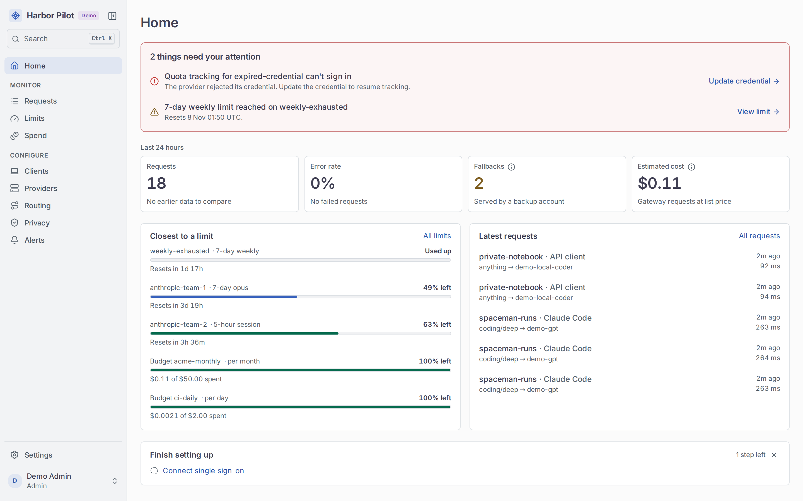
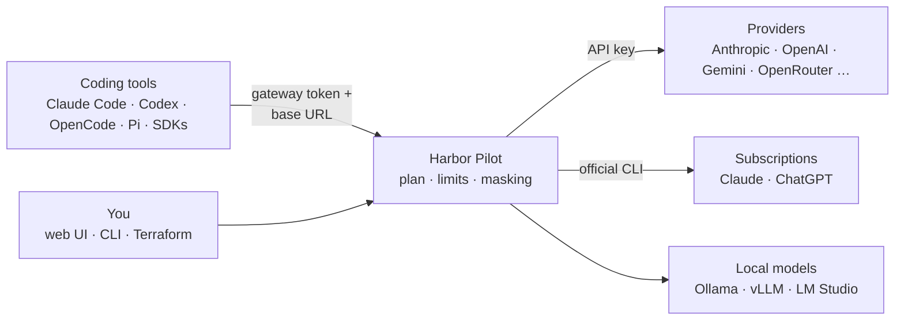
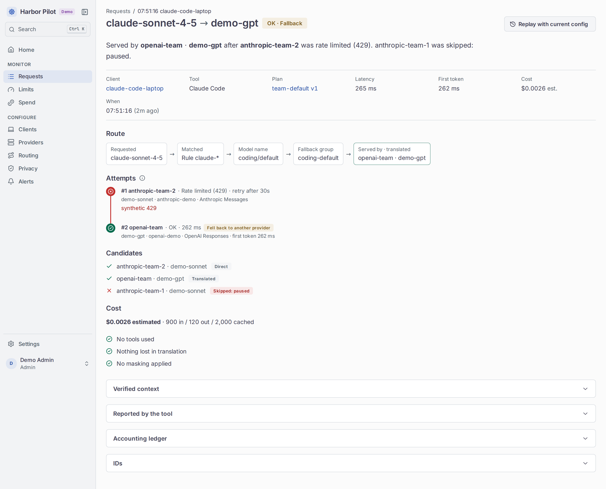
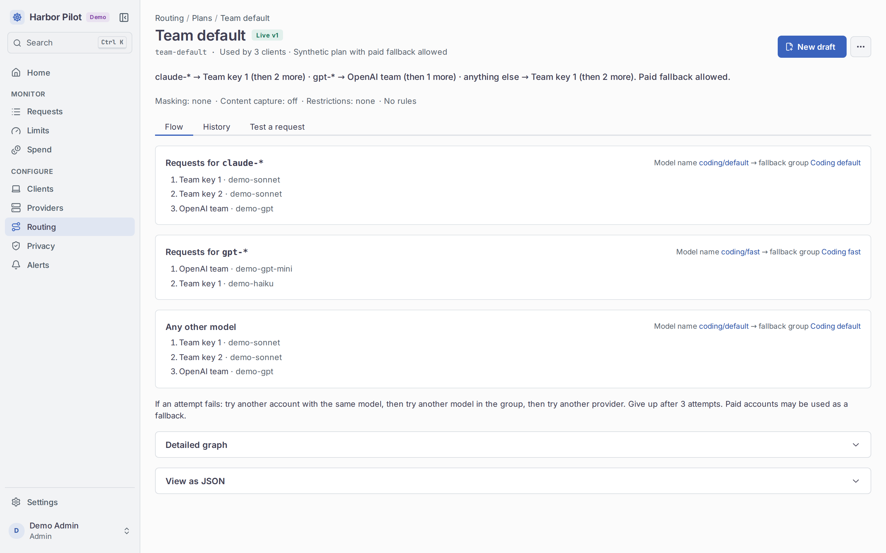
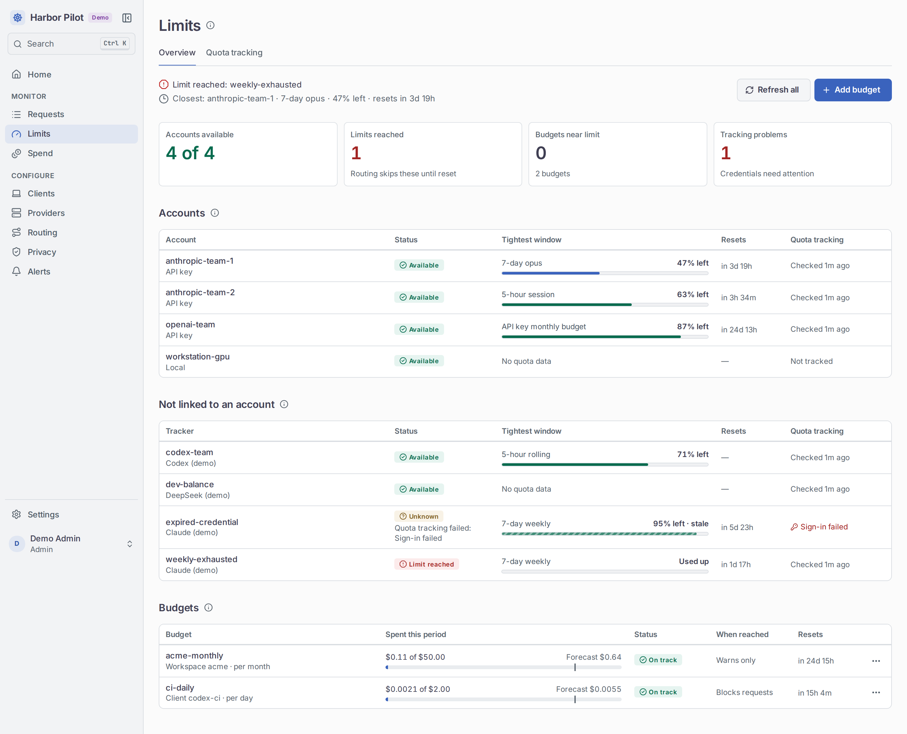
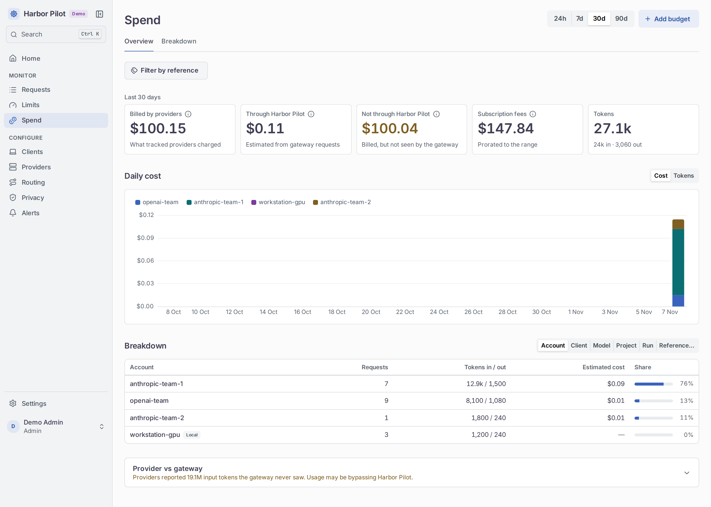
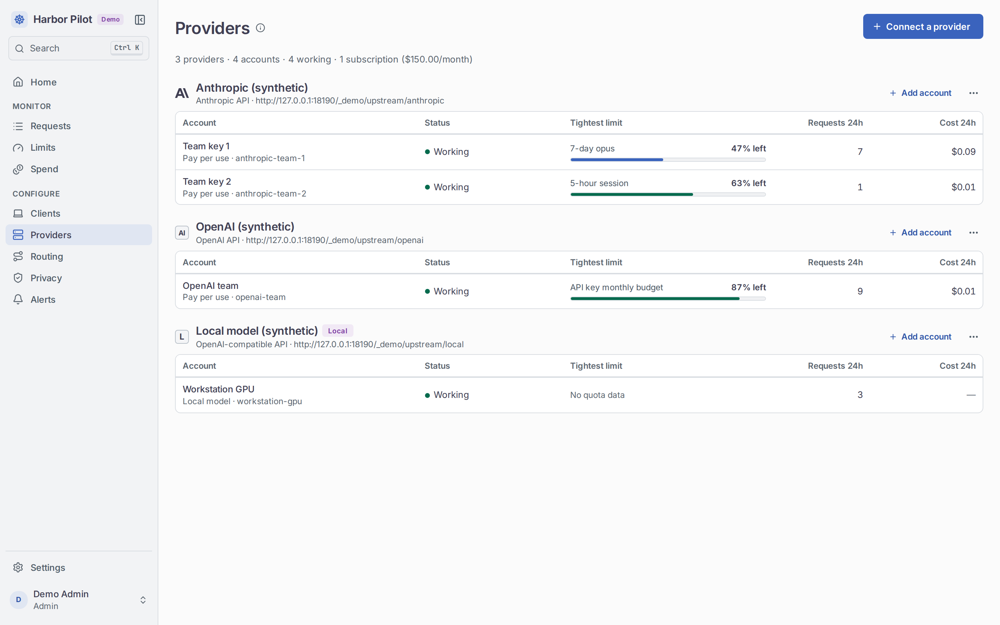
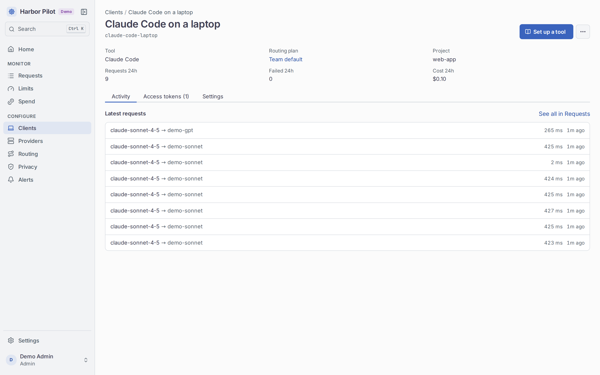
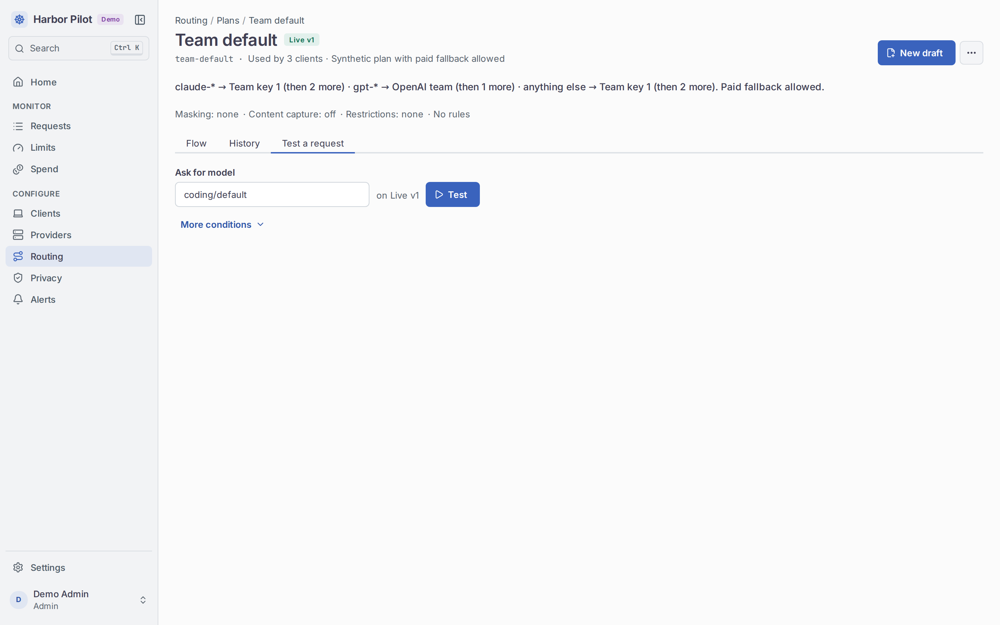
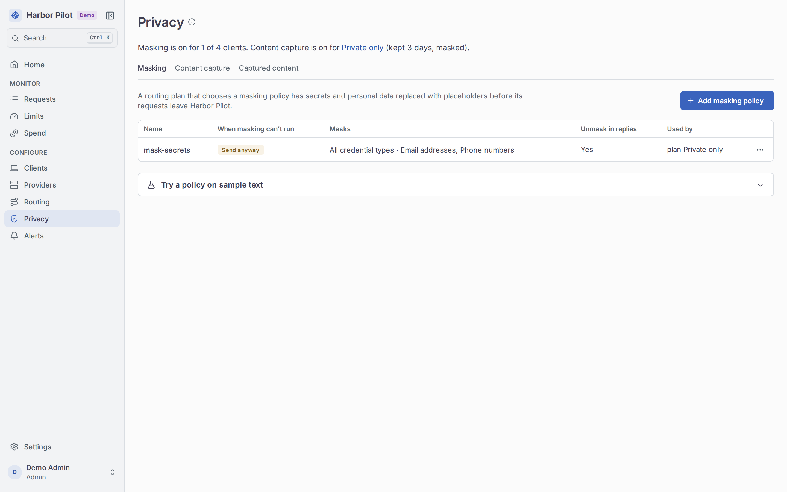

<p align="center">
  
</p>

<h1 align="center">Harbor Pilot</h1>

<p align="center">
  <strong>A self-hosted LLM gateway and policy control plane for coding agents.</strong><br>
  One URL for Claude Code, Codex, OpenCode and any SDK. Routing you can read, limits that tell the truth, secrets
  masked on the way out.
</p>

<p align="center">
  <a href="https://aurimasniekis.github.io/go-harbor-pilot/">Documentation</a> ·
  <a href="https://aurimasniekis.github.io/go-harbor-pilot/guide/demo">Try the demo</a> ·
  <a href="https://aurimasniekis.github.io/go-harbor-pilot/tools/">Connect a tool</a> ·
  <a href="https://aurimasniekis.github.io/go-harbor-pilot/security/">Security model</a>
</p>

<picture>
  <source media="(prefers-color-scheme: dark)" srcset="site/public/screenshots/home-dark.png">
  
</picture>

> **The current release is 0.1.6.** Every capability is covered by automated tests against fixtures, synthetic upstreams
> and fake binaries, and the reverse proxy configurations are verified against the real proxies. Runs against real
> provider accounts are tracked per cell in the
> [compatibility matrix](https://aurimasniekis.github.io/go-harbor-pilot/reference/compatibility). Until 1.0, minor
> versions may change configuration; the [upgrade notes](https://aurimasniekis.github.io/go-harbor-pilot/operators/upgrades)
> say what needs action.

## Why

Coding agents each want their own API key, their own base URL and their own idea of which model to use. You end up
with keys pasted into five config files, a Claude or ChatGPT subscription that runs out mid-task while an API key sits
idle, no idea what anything cost, and secrets from your repository flowing straight into prompts.

Harbor Pilot sits in between. Each tool gets **one gateway token and one base URL**. A routing plan you can read
decides which subscription, API key or local model serves each request, falls back when an account is rate limited,
and keeps within your quotas and budgets. Credentials in prompts are masked before a provider sees them. Every
request has a page that says, in one sentence, where it went and why.

## How it works



1. You add providers and accounts: API keys, subscription seats run through their own official CLI, or local
   endpoints.
2. You publish a routing plan: model names such as `coding/default` map to ordered fallback groups of
   account-and-model pairs, with restrictions and rules on top.
3. Each tool gets a client with its own access token; `harbor-pilot harness setup` writes the tool's config for you.
4. Every request is authenticated, routed, reserved against budgets, masked, executed (failing over before the first
   byte if an account is out), accounted for, and explained.

**Key features**

- **Every wire protocol.** OpenAI Chat Completions and Responses, Anthropic Messages and Gemini, with translation
  between them where a model needs it, streaming with keepalives, and native passthrough when a provider changes its
  protocol under you.
- **Subscriptions done properly.** Claude and ChatGPT seats run through the vendors' own CLIs (Claude Code and Codex)
  with isolated per-account config; their built-in tools are disabled and the client's tools are bridged.
- **Readable routing.** Plans with model names, fallback groups, hard restrictions, rules and decision tables. Drafts
  are validated, compared with what is live, and checked for whether they would block traffic before you publish.
- **"Why this route?"** For every request: the matched rule, every candidate and why it was skipped, every attempt,
  usage and cost.
- **Truthful limits.** Quota tracking for subscriptions and provider accounts, budgets enforced in the same
  transaction that reserves a request, and spend kept in separate categories: estimates, provider bills and
  subscription fees are never added together.
- **Secret masking.** Credentials, configured values and optional personal data are replaced with placeholders before
  a provider sees them and restored in replies, never into tool calls unless you allow it.
- **Captured content, briefly.** Optional encrypted traces kept for 24 hours, 3 days, 7 days or a custom period of
  up to 30 days, crypto-erased on expiry and readable only with an explicit, audited grant.
- **Alerts and events.** Telegram, Slack, Discord and webhook alerts, a durable outbox to Pulse (NATS JetStream) and
  signed webhooks.
- **Operators.** Local accounts with step-up re-authentication, OIDC single sign-on, API tokens for automation, and a
  readable audit log.
- **Configuration as code** with the
  [Terraform provider](https://github.com/aurimasniekis/terraform-provider-harbor-pilot).
- **One Go binary** with the web UI embedded and SQLite storage. Online backups and verified restore, Prometheus
  metrics, and container images with the CLI bridges included.

Harbor Pilot is **not a sandbox** and masking is defence in depth, not a guarantee: tools that run locally can still
read your files. The [security model](https://aurimasniekis.github.io/go-harbor-pilot/security/) says exactly what is
and is not protected.

## Screenshots

| | |
|---|---|
| <br>**Why this route** | <br>**Routing plans in plain words** |
| <br>**Quotas and budgets** | <br>**Spend** |
| <br>**Providers and accounts** | <br>**Clients and access tokens** |
| <br>**Test a request against a plan** | <br>**Masking policies** |

## Quick start

Try it with synthetic data. No provider is contacted and nothing leaves your machine:

```sh
git clone https://github.com/aurimasniekis/go-harbor-pilot.git
cd go-harbor-pilot
make dev         # builds the UI and binary, serves the demo on http://127.0.0.1:8080
```

Sign in as `admin@example.test` with the password `harbor-pilot-demo`.

To run it for real, see [Install with Docker](https://aurimasniekis.github.io/go-harbor-pilot/guide/install-docker)
or [Install the binary](https://aurimasniekis.github.io/go-harbor-pilot/guide/install-binary), put it
[behind a reverse proxy](https://aurimasniekis.github.io/go-harbor-pilot/guide/reverse-proxy) (tested nginx, Apache,
Caddy, Traefik and HAProxy configurations), then
[Connect your first tool](https://aurimasniekis.github.io/go-harbor-pilot/guide/first-tool). In short:

```sh
harbor-pilot keys generate > /etc/harbor-pilot/master.key && chmod 600 /etc/harbor-pilot/master.key
harbor-pilot serve --config /etc/harbor-pilot/harbor-pilot.yaml
harbor-pilot admin bootstrap --config /etc/harbor-pilot/harbor-pilot.yaml   # prints a one-time setup link
```

## Documentation

The [website](https://aurimasniekis.github.io/go-harbor-pilot/) is the user documentation: getting started, guides
for every screen, tool setup, security and reference. Contributor documents (architecture, decisions, threat model,
requirement traceability) live in [`docs/`](docs/README.md).

## Development

```sh
make check        # go vet, golangci-lint, gofmt, go test -race, web typecheck/lint/test/build
make e2e          # Playwright against the demo binary
make dev          # demo instance from the working tree
make screenshots  # regenerate the documentation screenshots
cd site && pnpm dev   # the documentation website
```

See [AGENTS.md](AGENTS.md) for conventions.

## License

Apache-2.0. See [LICENSE](LICENSE) and [NOTICE](NOTICE).
