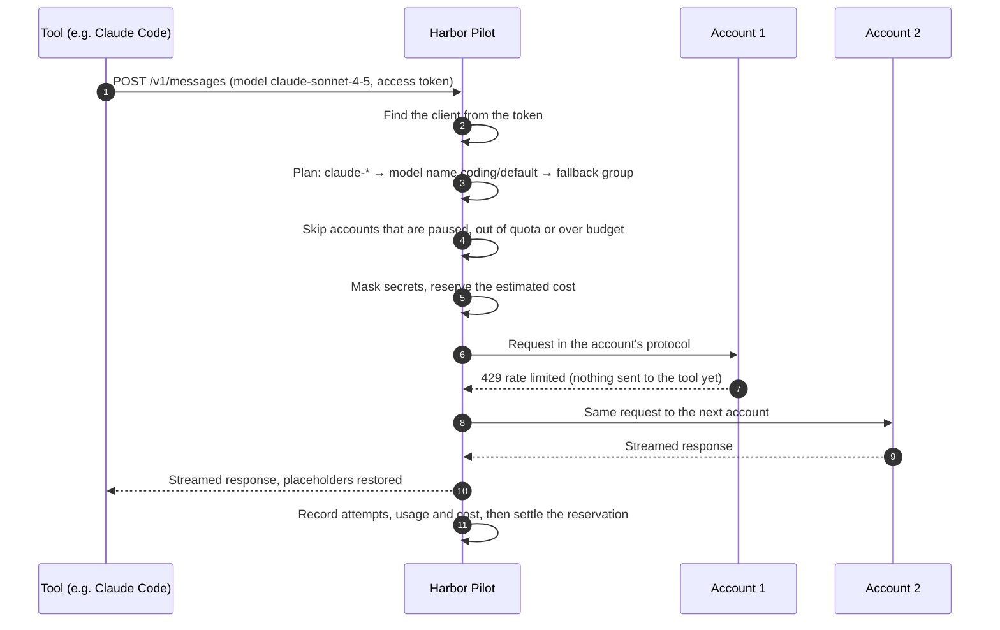

# Concepts

This page explains the words the UI uses and how a request travels through Harbor Pilot.

## The pieces

| Term | What it is |
|---|---|
| **Client** | One thing that sends requests: "Claude Code on my laptop", "Codex in CI", an app using the OpenAI SDK. A client has a routing plan, optional limits and a default project. |
| **Access token** | The secret a client sends with each request (`hpk_…`). It is shown once when created and stored only as a hash. A client can have several, so you can rotate them. |
| **Provider** | Where models live: the Anthropic, OpenAI or Gemini API, an OpenAI-compatible service (OpenRouter, DeepSeek, vLLM…), Ollama, or a subscription CLI bridge (Claude Code, Codex). It lists the models it serves and their prices. |
| **Account** | One credential at a provider: an API key, or a subscription sign-in for a CLI bridge. A provider can have many accounts. |
| **Subscription** | A plan an account is on (for example a monthly team plan), with its fee and declared limit windows. Used to show subscription consumption separately from metered spend. |
| **Model name** | The name a tool asks for, such as `coding/default`, mapped to a fallback group. Tools never need to know the real model id. |
| **Fallback group** | An ordered (or weighted) list of account and model pairs. When one can't serve a request, the next one tries. |
| **Routing plan** | The rules for a client: which requested model goes to which model name, hard restrictions, optional rules and decision tables, and what to do when an attempt fails. Plans are versioned: you edit a draft and publish it. |
| **Workspace and project** | Groups used for attribution and budgets. A client can attribute its requests to a project. |
| **Quota tracking** | Checks a provider or subscription for how much of each limit window is left. Routing skips accounts whose limit is used up. |
| **Budget** | A spending limit for a scope (everything, a workspace, a project, a client or an account) per day, week or month. It can warn or block. |
| **Masking policy** | What to hide from providers: built-in credential detectors, personal data, your own patterns and secret values. |
| **Content capture rule** | Whether request and response content is kept, for how long (up to 30 days) and how much of it. Off unless a plan opts in. |

## How a request flows

A few rules make this safe:

- **Failover only before the first byte.** Harbor Pilot moves to the next account only while nothing has been sent to
  the tool. Once a response starts streaming, it is never spliced with another one.
- **Hard restrictions first.** A plan's restrictions (allowed providers, billing types, required capabilities) are
  applied before any ranking, and nothing can override them.
- **Paid fallback is explicit.** Falling back from a subscription or local model to a metered API key only happens when
  the plan allows it.
- **Reservations are atomic.** The estimated cost of a request is reserved inside one database transaction, together
  with the budget check, so concurrent requests can't overspend a budget.

## Where the routing decision comes from

<Shot name="plan" alt="A routing plan described in plain words: claude models to Team key 1 then two more, gpt models to OpenAI team, with the failover steps" caption="A plan's Flow tab says in plain words what each requested model resolves to" />

A plan resolves the requested model in this order:

1. If the requested name is a model name (for example `coding/default`), use it.
2. Otherwise the first matching mapping (`claude-*` → `coding/default`).
3. Otherwise the plan's default model name, or refuse the request if there is none.

The model name points to a fallback group, and the group lists the candidates. Rules and decision tables can block a
request, require capabilities, set its intent or prefer some candidates; the [routing guide](/operators/routing)
covers them.

## Every request is explained

<Shot name="request" alt="A request page: served by OpenAI team after anthropic-team-2 was rate limited, with the route, attempts, candidates and cost" caption="The request page answers 'why this route?' in one sentence" />

The request page shows the route from requested model to the account that served it, each attempt with its outcome,
the candidates that were considered or skipped and why, the cost, and what was masked. See
[Requests](/operators/requests).

## Trusted and reported information

Harbor Pilot separates what it knows from what a tool claims:

- **Verified:** the client, its plan and project, and references bound to an access token when it was created (for
  example an orchestrator's run id). These decide routing, limits and attribution.
- **Reported by the tool:** headers such as a session id or a project hint. They are recorded and shown, but only used
  when the client is configured to trust them, and never for authorization.
