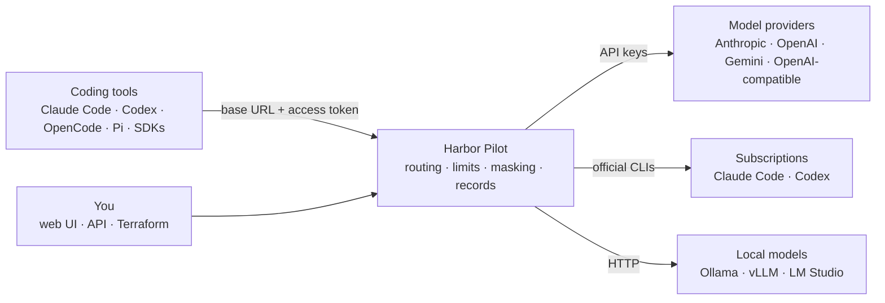

# What is Harbor Pilot?

Harbor Pilot is a self-hosted gateway between your coding agents and the models they use. You point Claude Code,
Codex, OpenCode, Pi or any OpenAI, Anthropic or Gemini SDK at one URL with one token. Harbor Pilot decides which
account and model serves each request, keeps track of quotas, budgets and costs, masks secrets before they leave,
and records why every request went where it did.

It is a single Go binary with the web UI built in and SQLite for storage.

<Shot name="home" alt="Harbor Pilot home page with three things that need attention, request and cost figures, the limits closest to running out and the latest requests" caption="Home: what needs attention first, then the numbers" />

## The problem

A typical setup has several coding tools, a couple of subscriptions, a few API keys and maybe a local model. Each
tool is configured by hand, each key lives in several places, and when a subscription hits its weekly limit you find
out because your agent stops working. Nobody can say afterwards which account a request used, what it cost, or why.

Harbor Pilot puts one control point in the middle:

- **One configuration per tool.** A tool gets a base URL and an access token. Which providers, accounts and models
  stand behind it is decided centrally and can change without touching the tool.
- **Routing you can read.** A routing plan maps the model a tool asks for to an ordered list of accounts and models.
  When one is rate limited or out of quota, the next one serves the request, before your tool sees anything.
- **Limits that are honest.** Quota windows of subscriptions and API accounts are tracked and shown with when they
  reset. Budgets are enforced in the same transaction that reserves a request, so they can't be overspent by a burst.
- **Secrets stay home.** Credentials and personal data in prompts are replaced with placeholders before the request
  leaves, and restored in the reply.
- **Every decision explained.** Each request has a page that says in one sentence where it went and why.

## How it fits

Tools talk to Harbor Pilot in their own wire protocol (Anthropic Messages, OpenAI Chat Completions, OpenAI Responses
or Gemini). Harbor Pilot translates when the chosen model speaks a different one.

Subscriptions are used only through the vendor's own command-line tool (`claude` and `codex`), run by Harbor Pilot
with the account's own sign-in. Harbor Pilot never replays subscription tokens directly or pretends to be another
client.

## What it is not

- **Not a way around provider rules.** Account switching only chooses among accounts you are allowed to use.
- **Not an invoice.** Subscription usage is shown as consumption, never as a bill. Estimated costs, provider bills and
  subscription fees are kept as separate figures and never added together.
- **Not a sandbox.** Masking is defence in depth for what passes through the gateway. Tools that read files or run
  commands locally are outside what it can see.
- **Not a cluster.** One instance runs on one SQLite database. Recovery is by restoring a backup.

## Status

The current release is **0.1.6**. Every feature on this site is implemented and covered by automated tests
against synthetic providers and fake command-line tools, and the [reverse proxy configurations](/guide/reverse-proxy)
are verified against the real proxies. Runs against real provider accounts are still to come: the
[compatibility matrix](/reference/compatibility) says, for each protocol, provider and tool, exactly what has been
tested and how. Until 1.0, a minor version may change configuration; [Upgrades](/operators/upgrades) lists what
needs action.

## Next steps

- [Concepts](/guide/concepts): clients, providers, accounts, model names, fallback groups and plans.
- [Try the demo](/guide/demo): a local instance with synthetic data, in one command.
- [Install with Docker](/guide/install-docker) or [as a binary with systemd](/guide/install-binary).
