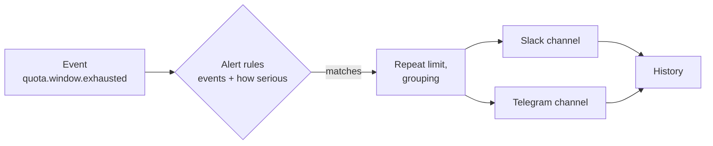

# Alerts

Alerts tell a person that something needs them: a subscription ran out of quota, a budget is nearly used up, an
account keeps failing, a protocol path was paused. They go to **Slack**, **Discord**, **Telegram** or your own
**signed webhook**.

Alerts are built from [events](/operators/events). Harbor Pilot records an event for every state change that matters,
and an **alert rule** picks the events you care about and sends them to one or more **channels**.



Alerting never slows the gateway. Events are written in the same transaction as the change that caused them and
delivered in the background, so a failing channel can't block a request.

::: info Status
The Slack, Discord, Telegram and webhook adapters are **contract-tested** against local fakes of each service. They
have not been run against the live services yet. See [Compatibility](/reference/compatibility).
:::

**Alerts** has four tabs: **Channels**, **Rules**, **History** and **Event relays** (see [Events](/operators/events)).

## Channels

<Shot name="alerts" alt="Alerts page on the Channels tab, listing alert channels with where they send to, their delivery settings, an on/off switch, a Send test button and the rules that use them" caption="Alerts → Channels" />

Each channel shows where it **Sends to**, its **Delivery** settings, a **Status** switch (off shows *Off — not
sending*), a **Send test** button and the rules that use it.

### Add a channel

**Alerts → Channels → Add channel**, then answer *Where should alerts go?*

<Shot name="alert-channel" alt="Add alert channel dialog with the channel type chosen, a name, the secret to store and the delivery settings" caption="A channel needs a name and one secret; the rest has defaults" />

| Type | What you need | Notes |
|---|---|---|
| **Slack** | An incoming webhook URL (Slack: *Apps → Incoming Webhooks*, starts with `https://hooks.slack.com/services/`) | The URL is the secret. |
| **Discord** | A channel webhook URL (*Channel settings → Integrations → Webhooks*, starts with `https://discord.com/api/webhooks/`) | The URL is the secret. Mentions are disabled, so an alert can't ping `@everyone`. |
| **Telegram** | A bot token from @BotFather, and the **Chat ID** of the chat, group or channel (for example `-1001234567890`) | The bot must be a member of the chat. |
| **Signed webhook** | A **Webhook URL** and, optionally, a **Signing secret** | Each alert is POSTed as JSON. See [verifying signatures](/operators/events#verify-a-webhook-signature). |

The secret is stored encrypted and never shown again. Instead of pasting it you can choose **Use a secret kept on the
server instead** and name an environment variable or file, for example `env:HP_SECRET_SLACK_WEBHOOK` or
`file:/run/secrets/slack-webhook`. Variables need an allowed prefix (by default `HP_SECRET_`).

A webhook URL must be a public HTTPS address. For a self-hosted receiver, tick **Receiver is on a private network**.
The same applies to Telegram's **API base URL override** (only for a self-hosted Bot API server), with **Relay is on a
private network**. That allows plain
http and loopback or LAN addresses. Cloud metadata addresses stay blocked either way.

**Send test** sends one test message right away. Test messages can't be re-sent from History.

### Delivery: quiet hours and noise control

Open **Delivery** in the channel dialog.

| Setting | What it does |
|---|---|
| **Time zone** | Used for quiet hours and digests. Defaults to UTC. |
| **Quiet hours** | Between **Quiet from** and **Until**, non-critical messages are held and sent as one digest when quiet hours end. |
| **Critical messages still go out** | Critical alerts skip quiet hours. |
| **Digest every** | During quiet hours, send a digest this often (minutes). `0` sends one digest when quiet hours end. |
| **At most** | Messages per minute for this channel (default 20, 1–600). Extra messages wait for the next digest. |

Slack, Discord and Telegram rate limits are respected: when a service answers "slow down", Harbor Pilot waits as long
as it asks before retrying.

## Rules

<Shot name="alert-rule" alt="Add alert rule dialog with presets, an event picker, a severity choice, the channels to send to, and how often to repeat" caption="An alert rule: which events, how serious, where to, how often" />

**Alerts → Rules → Add alert rule.**

1. **Short name**, and the **Rule on** switch.
2. **When**: pick events. **Start from** offers presets:

   | Preset | Events |
   |---|---|
   | **Quota used up** | Quota used up, Quota tracking cannot sign in |
   | **Budget warnings** | Budget near its limit, Budget used up |
   | **Account paused** | Account paused after errors |
   | **Protocol path paused** | Protocol path paused |

   The **Events** picker groups every event kind by area (Quota, Budget, Provider accounts, Routing, Access, Protocol
   paths, Protocol changes, Routing plans, Configuration), each with an "any … event" choice. With no events picked,
   every event matches.
3. **How serious**: **Everything**, **Warnings and critical** or **Critical only**. The dialog shows how many event
   kinds the rule matches.
4. **More conditions** narrows the rule to one provider, account, client or other subject from the event.
5. **Send to**: tick channels. A channel that is off is marked *This channel is off, so nothing is sent through it*.
6. **How often**:
   - **Repeat alerts for the same problem**: **Every time**, **At most every 15 minutes** (default), **every hour**,
     **every 6 hours**, **once a day**, or **Custom…** (**Wait at least** N minutes).
   - **Tell me when it recovers**: also send a message when the problem clears, for example *Quota available again* or
     *Protocol path restored*.

Rules can't subscribe to alert or event-delivery events themselves (`notification.*`, `event.*`), so an alert can't
trigger another alert.

### Custom message and grouping

- **Group repeats for** (minutes): after the first message, repeats of the same problem are counted and sent as one
  summary. `0` sends each one.
- **Message**: an optional Go template, at most 2,000 characters. Empty sends every data field of the event.

  | Variable | Meaning |
  |---|---|
  | <code v-pre>{{.Name}}</code> | Event name, for example `quota.window.exhausted` |
  | <code v-pre>{{.Severity}}</code> | `info`, `warning` or `critical` |
  | <code v-pre>{{.Kind}}</code> | `alert`, `recovery`, `digest` or `test` |
  | <code v-pre>{{.OccurredAt}}</code> | When the event happened |
  | <code v-pre>{{.Subjects.provider_id}}</code> | An identity from the event's subjects |
  | <code v-pre>{{.Data.reason}}</code> | A field from the event's data (see the [event catalog](/reference/events)) |
  | <code v-pre>{{.Data.label &#124; upper}}</code> | `upper` is the only helper function |

## History

**Alerts → History** lists every message: what was sent, to which **Channel**, its **Status** and **When**. Filter by
channel and status.

| Status | Meaning |
|---|---|
| **Waiting** | Queued or being retried. |
| **Held for digest** | Held by quiet hours or the rate limit. |
| **Sent in a digest** | Delivered as part of a digest. |
| **Sent** | Delivered. |
| **Failed** | Gave up after its retries. The line says how many attempts were made. |

A failed message can be sent again (**Send again**). It goes back into the queue and is retried like a new message.

## With Terraform

```hcl
resource "harborpilot_notification_channel" "ops" {
  name = "ops-telegram"
  spec = jsonencode({
    type             = "telegram"
    telegram_chat_id = "-1001234567890"
    secret_ref       = "env:HP_SECRET_TELEGRAM_BOT_TOKEN"
    quiet_hours      = { enabled = true, start = "22:00", end = "07:00", critical_bypass = true }
    timezone         = "Europe/Vilnius"
    enabled          = true
  })
}

resource "harborpilot_notification_rule" "quota" {
  name = "quota-alerts"
  spec = jsonencode({
    channel_ids      = [harborpilot_notification_channel.ops.id]
    filter           = { events = ["quota.*", "budget.*"], min_severity = "warning" }
    cooldown_seconds = 1800
    recovery         = true
    enabled          = true
  })
}
```

See [Terraform](/operators/terraform) and the provider's `06-pulse-events-notifications` example.

## Related

- [Events](/operators/events): the event stream, Pulse and signed webhooks.
- [Event catalog](/reference/events): every event kind and its data.
- [Limits](/operators/limits): the quotas and budgets most alerts are about.
