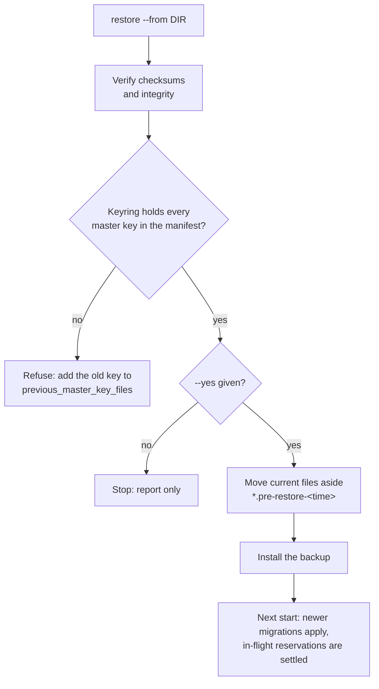

# Backup and restore

Harbor Pilot keeps everything in two SQLite files in its data directory:

- `harbor.db`: configuration, the accounting ledger, request records, quota history, the event outbox and the audit
  log.
- `traces.db`: [captured content](/operators/captured-content), encrypted and short-lived.

Stored secrets in both are sealed with the **master key**, which is never in the database and never in a backup. A
complete recovery needs a backup **and** the master key.

::: info Status
Backup, verify and restore are **contract-tested** (acceptance scenario M: back up a running server, restore into a
fresh data directory, and check that accounting is not double-counted).
:::

## Take a backup

Backups are online: the server keeps serving while one is taken. Each backup is a directory with a consistent copy of
`harbor.db` (made with SQLite `VACUUM INTO`) and a `manifest.json` recording the format version, the creation time,
the server version, each file's SHA-256, size and schema version, and the ids of the master keys that sealed its
secrets. Files are created readable only by the server's user.

### From the command line

```sh
harbor-pilot backup --config /etc/harbor-pilot/config.yaml                   # into <data-dir>/backups/<time>
harbor-pilot backup --config /etc/harbor-pilot/config.yaml --out /srv/backups/hp-2026-11-06
harbor-pilot backup verify /srv/backups/hp-2026-11-06
```

`backup verify` recomputes the checksums and runs SQLite's `integrity_check` and `foreign_key_check`.

### From the UI

**Settings → System & backups → Take backup** (admins). Tick **Include captured content** to add `traces.db`. Backups
taken here are written under `<data-dir>/backups`. Each one in the list can be **Download**ed as a `.tar.gz` archive
or deleted. Downloads and deletions are [audited](/operators/audit).

A backup that only lives in the data directory doesn't protect you from losing the disk: download it or copy it off
the host. The API equivalent is `POST /api/v1/system/backups`.

### Captured content is left out by default

`traces.db` is short-lived by policy, so backups skip it unless you pass `--include-traces` (or tick **Include
captured content**). Such a backup stays encrypted, but it holds copies of the keys that expiry would otherwise
destroy: the captures in it stay readable for as long as the backup exists. Delete those backups on the same schedule
as your capture retention.

### Back up the master key separately

Losing the master key makes every stored secret and every capture unrecoverable. Keep a copy somewhere other than your
database backups (a password manager or a secrets vault). Storing it next to the backups defeats encryption at rest.

The key's fingerprint (not secret) is shown on **System & backups** under **This instance → Master key**, and in each
backup's manifest, so you can match a key to its backups. See
[Secrets and the master key](/security/secrets).

## Schedule backups

Backups are cheap, so take one daily from a timer or cron job, copy it off the host, and verify the copy:

```sh
d=/srv/backups/hp-$(date -u +%F)
harbor-pilot backup --config /etc/harbor-pilot/config.yaml --out "$d" && harbor-pilot backup verify "$d"
```

With Docker, run the same command in the container:

```sh
docker exec harbor-pilot harbor-pilot backup --out /data/backups/hp-$(date -u +%F)
```

## Restore

A restore replaces the databases, so the server must be stopped. `restore` takes the same data-directory lock as
`serve` and refuses to run while a server holds it.

```sh
systemctl stop harbor-pilot
harbor-pilot restore --from /srv/backups/hp-2026-11-06 --config /etc/harbor-pilot/config.yaml        # check only
harbor-pilot restore --from /srv/backups/hp-2026-11-06 --config /etc/harbor-pilot/config.yaml --yes  # install
systemctl start harbor-pilot
```

To restore a backup downloaded from the UI, unpack the archive into a directory first and pass that directory.



1. The backup is verified.
2. The configured keyring must hold every master key id in the manifest. If you rotated the key after the backup, list
   the old key in `security.previous_master_key_files`.
3. The current `harbor.db` and `traces.db` (with their `-wal` and `-shm` files) are moved aside as
   `*.pre-restore-<time>`.
4. The backup is installed. Without captured content in it, the server starts with an empty `traces.db`.

On the next start, migrations newer than the backup are applied, and reservations that were in flight when the backup
was taken are settled by startup recovery. Spend is not counted twice.

Remove the `*.pre-restore-*` files once you are happy with the restored state.

## Related

- [Upgrades and rollback](/operators/upgrades): rolling back an upgrade is a restore.
- [Secrets and the master key](/security/secrets): rotating the key without losing old backups.
