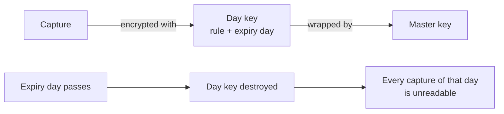

# Captured content

Harbor Pilot always records **request details**: who sent a request, which route it took, the attempts, tokens, cost
and timing. That is what you see in [Requests](/operators/requests). It does **not** keep what was said (the prompts,
tool calls and replies) unless you ask it to.

**Content capture** keeps a copy of the content for a short time so you can debug a tool or a routing problem. It is
off by default. When it is on, the copy is masked, encrypted, kept only for the time you choose, and readable only by
people you grant it to. Every read is audited.

::: info Status
Capture, expiry and crypto-erasure, search and the access grants are **contract-tested** (test scenarios F and G in
the acceptance suite). Physical erasure from disk has limits that are spelled out in
[Known limitations](/security/limitations).
:::

## Capture rules

A **capture rule** says what to keep and for how long. Like a masking policy, it is attached to a routing plan, on the
plan's **Privacy** tab. Clients on plans without a rule capture nothing.

**Privacy → Content capture → Add capture rule.**

<Shot name="capture-rules" alt="Content capture tab listing a capture rule with what it keeps, how long, which masking it uses, whether downloads are allowed and which plans use it" caption="Privacy → Content capture: one rule, kept 3 days, masked, used by one plan" />

### What to keep

| Choice | What is kept |
|---|---|
| **Nothing (off)** | No content. Request details are still in **Requests**. |
| **Masked excerpts** | Masked text, with long texts shortened to their first and last 1,000 characters. |
| **Masked full content** | All of the masked content. Recommended, with 3-day retention. |
| **Unredacted (privileged, time-boxed)** | The content as the client sent it, secrets included. For a short investigation only. |

**Unredacted** needs the `traces.content.unredacted` grant to set up, and a required end time, **Unredacted capture
ends at**, at most seven days ahead. After that time the rule falls back to masked full content by itself.

### How long, and masked with what

- **Keep for**: 24 hours, 3 days, 7 days, or **Custom** from 1 to 720 hours (30 days).
- **Mask captured content with**: the built-in credential detectors, or one of your
  [masking policies](/operators/privacy). The same masking is applied to the search index.

### Limits

| Field | Meaning |
|---|---|
| **Largest capture** | The largest single capture, in MB (at most 16). Sections that don't fit are dropped and marked. |
| **Space per plan** | Total space for the plan's captures, in MB. When it is full, new captures are skipped and counted. |
| **Capture % of requests** | Sample a share of requests instead of all of them. |

The defaults are masked full content, kept 3 days, 1 MiB per capture and 512 MiB in total.

### What is captured

You can turn each section on or off:

- **Client request**: what the client sent.
- **Request as sent upstream**: after masking, with placeholders standing in for masked values.
- **Response**: what the model produced, before placeholders were put back for the client.
- **Stream event summary**: event kinds and sizes, not content.
- **Attempts**: each account and model tried, why and with what result.
- **Routing decision**: the plan's reasoning.

**Allow downloads** lets people with the `traces.export` grant download a capture. It is off by default.

## Who can read it

Roles don't include content access. An admin grants it per person, under **Settings → People**, in **Captured content
access**:

| Grant | Allows |
|---|---|
| Read masked captured content (`traces.content.read`) | Reading masked captures. |
| Read unredacted diagnostic captures (`traces.content.unredacted`) | Reading unredacted captures. |
| Export captured content (`traces.export`) | Downloading captures, when the rule allows downloads. |

Anyone with `traces.metadata.read` (every role) can see *that* something was captured, but not read it. Deleting a
capture needs `traces.delete` (operators and admins).

Reading unredacted content and downloading both need a **recent sign-in**: within the last 10 minutes. Otherwise
the action is refused with a message asking you to sign in again. API tokens never qualify, so an automation
token can't read unredacted content or download it. See [People, API tokens and sign-in](/operators/access#step-up-sign-in).

Every read, download, denial and deletion is written to the [audit log](/operators/audit).

## Find and read captured content

**Privacy → Captured content.**

<Shot name="captured" alt="Captured content tab showing a lock notice that explains reading needs a grant from Settings, People, and that every read is audited" caption="Without a content grant you see this notice instead of the content. The demo admin has no grant." />

- **Find by** switches between **Words in content** (a full-text search over the masked text, which needs the read
  grant) and **Request or session id**. The search index holds only masked text, even for unredacted captures.
- The client filter narrows the list to one client.
- The list shows when content was **Captured**, the **Client** (with a link to the request), the **Plan**, the
  **Content** mode, when it is **Kept until** and its **Size**. A shortened capture is marked **Shortened**.

Opening a capture shows the sections above. An unredacted capture carries a warning that it may include secrets the
client sent. From a request page in **Requests**, the captured content of that request is one click away.

**Delete** erases a capture and its search entries now, instead of at expiry. The request details stay in **Requests**.

## Expiry and crypto-erasure

Each capture is encrypted with a key that belongs to its capture rule and its expiry day. That key is wrapped by the
master key.



- Expiry is enforced when content is read: an expired capture is never returned or found by search, even if it is
  still on disk.
- A background sweep then removes expired rows and their search entries in small batches.
- When a day key is destroyed, everything encrypted with it is unreadable, including copies left in old database pages.
  This is **crypto-erasure**.
- A backup taken with `--include-traces` keeps its own copy of the day keys. Treat such a backup as holding the
  captures until you delete it.

Captures live in a separate database (`traces.db`) and are **not** in backups unless you ask for them with
`harbor-pilot backup --include-traces`. See [Backup and restore](/operators/backup).

## API

| Endpoint | Permission |
|---|---|
| `GET /api/v1/traces` (metadata only) | `traces.metadata.read` |
| `GET /api/v1/traces/search` (masked text) | `traces.content.read` |
| `GET /api/v1/traces/{id}` | `traces.content.read`, plus `traces.content.unredacted` and a recent sign-in for unredacted content |
| `GET /api/v1/traces/{id}/export` | `traces.export`, a recent sign-in, and a rule that allows downloads |
| `DELETE /api/v1/traces/{id}`, `DELETE /api/v1/traces` | `traces.delete` |

Exports are generated on demand and never cached.

## With Terraform

```hcl
resource "harborpilot_trace_policy" "three_days" {
  name = "3-day-traces"
  spec = jsonencode({
    mode                = "masked_full"
    retention           = "3d"
    redaction_policy_id = harborpilot_privacy_policy.strict.id
    sample_rate         = 1
    allow_export        = false
  })
}
```
