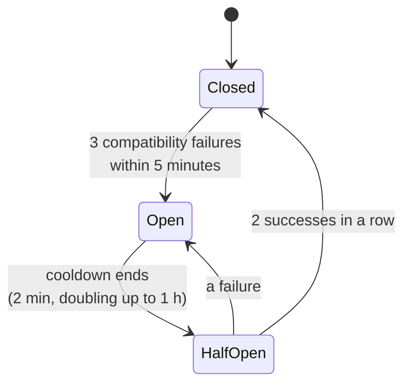

# Diagnostics

Providers change their APIs, sometimes without notice: a new stream event, a renamed field, a request shape that
starts being rejected. Harbor Pilot translates between protocols, so a change like that can break a route even though
the provider is up. **Diagnostics** is where you see that happening and what Harbor Pilot did about it.

**Settings → Diagnostics** has three tabs:

- **Protocol issues**: circuit breakers and the routes running degraded right now.
- **Protocol changes**: what Harbor Pilot has observed changing in provider traffic.
- **Follow-ups**: one item per observed change, for you to triage.

<Shot name="diagnostics" alt="Settings, Diagnostics tab on Protocol issues, showing no degraded routes and no circuit breakers yet" caption="Settings → Diagnostics on a healthy instance: nothing degraded, no breakers" />

::: info Status
Breakers, passthrough and Protocol Watch are **contract-tested** (acceptance scenarios H, I and J use a synthetic
upstream that changes its protocol mid-run). See [Compatibility](/reference/compatibility).
:::

## Circuit breakers

There is one breaker per **provider and protocol path**, for example *Anthropic Messages in → OpenAI Responses out* on
one provider. Only **compatibility failures** count: output Harbor Pilot can't parse, or a request the provider rejects
as malformed. Authentication errors, rate limits and outages don't; those are handled by account cooldowns and
fallback (see [Routing plans](/operators/routing)).

- **Closed**: the path routes normally.
- **Open**: the path is paused. Requests that would use it follow the plan's choice below.
- **Half-open**: after the cooldown, one real request goes through normally to test the path. Two successes close the
  breaker; a failure opens it again with a longer cooldown.

Each breaker transition is an [event](/operators/events): `compat.breaker.opened`, `.half_opened` and `.closed`.
**Protocol path paused** is one of the [alert rule](/operators/alerts) presets. While any breaker is open, the app
shows a banner on every page.

A breaker appears in the list only once its path has recorded a compatibility failure. The list shows its state, the
**Next probe**, **Recent failures** and the **Last failure**.

### Override a breaker

Needs `compat.manage` (operators and admins). On a breaker, choose a **Mode**:

| Mode | Effect |
|---|---|
| **Automatic: pause and resume on failures (default)** | As described above. |
| **Pause this path (breaker forced open)** | Stop using the path, for example while you wait for a fix. |
| **Keep using this path (breaker forced closed)** | Requests keep going through even if the upstream is still incompatible. |

Give a **Reason**: it is recorded in the [audit log](/operators/audit) and shown with the breaker. Forcing a breaker
closed needs **Confirm override**.

**Run live canary…** sends one synthetic request (no real prompt) to the provider now, to test an open or half-open
breaker without waiting. It is a real upstream call on that account.

## What a plan does while a breaker is open

Each [routing plan](/operators/routing) decides, on its **Compatibility** tab:

| Setting | Choices |
|---|---|
| **When a breaker is open** | **Skip the candidate (fail over or fail)**: try the next account in the fallback group, or fail. **Use native passthrough (pre-authorized losses)**: forward the client's request unchanged to an upstream that speaks the client's protocol. |
| **Pre-authorized losses while degraded** | What passthrough may give up: **Detailed usage**, **Tool statistics**, **Masking**, **Intent inspection**, **Traces**. |
| **Unknown usage** | When passthrough can't read token counts: **Record as unknown usage** or **Estimate from request and response size**. |
| **Unenforceable token budgets** | **Refuse passthrough when a blocking budget applies** or **Allow passthrough anyway**. |

Concurrency and request-rate limits stay enforced in every mode.

Passthrough is only possible to an upstream speaking the client's own protocol, never to a CLI bridge, and it always
loses detailed usage and tool statistics, so those must be pre-authorized. If the plan has a masking policy, Masking
must be pre-authorized too, and a policy set to **Block the request** refuses passthrough anyway (see
[Privacy](/operators/privacy#when-masking-can-t-run)). Content capture is suspended while passthrough serves a
request. Each passthrough decision is an event: `compat.passthrough.activated`, `.blocked` or `.deactivated`.

**Active degradation** on the Protocol issues tab lists, for each published plan that routes through a paused path,
what it is doing instead and which features it is giving up.

## Protocol changes

**Protocol changes** is Harbor Pilot's own changelog of what it saw change in provider traffic. It is an *observed*
changelog, not a provider's release notes. It records structure only: field names, event types and value types, never
content.

| Kind | Meaning |
|---|---|
| **New event** | A stream event type not seen before. |
| **New field** | A field not seen before. |
| **New enum value** | A new value in a field with a fixed set of values. |
| **Type change** | A field changed type. |
| **Expected field absent** | A field that used to be there wasn't seen. Low confidence: *not observed* is not proof of removal. |
| **Unsupported sequence** | Events arrived in an order the translator doesn't handle. |
| **Schema rejection** | The provider rejected a request shape. |
| **Parse failure** | The response couldn't be parsed. |
| **Compatibility restored** | A previously broken path works again. |

Filter by **Kind** and **Impact** (**Breaking**, **Additive**, **Unknown**). Each change shows its **Confidence**,
the **Structural detail**, the provider and direction, and when it was first and last seen. A change not seen in the
last 7 days is marked as such. Each new change is a `protocol.change.detected` event.

The observer runs beside the request path with a bounded queue. If it falls behind it drops observations and counts
them; it never slows a request.

## Follow-ups

**Follow-ups** turns each observed change into one work item. Repeats add evidence instead of new items, and a
resolved item reopens if the change comes back.

Open an item to see:

- **Change**: the sanitized structural diff.
- **Action taken and features lost**: what Harbor Pilot did automatically, for example opened a breaker.
- **Affected routes**: provider and protocol path.
- **Evidence**: request ids only. Their request records or captures may already have expired; the structural record
  stays.

**Triage** (needs `compat.manage`): set the **Status** (**New**, **Acknowledged**, **Investigating**, **Fix
available**, **Verified**, **Resolved**, **Ignored**), an **Issue URL**, **Commit**, **Release** and **Notes**. Saving
fails if someone else changed the item since you opened it.

**Synthetic fixture** builds a test fixture from the structural diff, with placeholder values only. Tick **Reviewed and
safe to add to the protocol test fixtures** once you've checked it. Regenerating clears the reviewed flag.

## API

| Endpoint | Purpose |
|---|---|
| `GET /api/v1/compat/breakers` | Breakers and their state. |
| `GET /api/v1/compat/degradations` | What each plan is doing while paths are paused. |
| `POST /api/v1/compat/breakers/override` | Force a breaker open or closed, or back to automatic. |
| `POST /api/v1/compat/breakers/probe` | Run a live canary. |

The `hp_compat_breakers` metric counts breakers by state (see [Monitoring](/operators/monitoring)).
