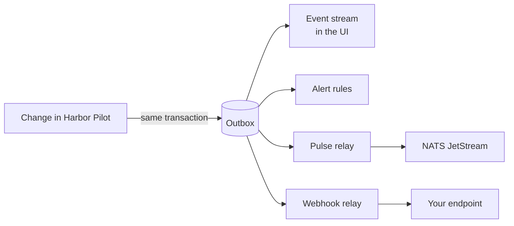

# Events: Pulse and signed webhooks

Harbor Pilot records an **event** for every state change worth knowing about: a quota ran out, a budget crossed a
threshold, a request fell back to another account, a protocol path was paused, a plan was published, any configuration
object changed. Events feed three things:

- the **event stream** in the UI (**Settings → Event stream**);
- [alert rules](/operators/alerts), which turn events into messages for people;
- **event relays**, which forward events to other systems: **Pulse** (NATS JetStream) or a **signed webhook**.



An event is written in the same database transaction as the change that caused it, so there is never a change without
its event or an event without its change. Relays read from that outbox in the background and never slow the gateway.

::: info Status
The outbox, relays, retries and replay are **contract-tested**. The Pulse relay is tested against an embedded NATS
JetStream server; it has not been run against a live Pulse instance yet. Signed webhooks are tested against local
receivers. See [Compatibility](/reference/compatibility).
:::

## The event stream

**Settings → Event stream** shows recent events, newest first.

<Shot name="event-stream" alt="Settings, Event stream tab, showing recent events with their names, severity, subjects and times, and filters for problems, all events and configuration changes" caption="Settings → Event stream: what happened, most recent first" />

- The filter switches between **Problems** (warnings and critical), **All events** and **Configuration changes**, and
  can narrow to one event kind.
- **Catalog** lists every event kind with its severity, the subjects it carries, its data fields and which event
  resolves it.

The API equivalents are `GET /api/v1/events` and `GET /api/v1/events/catalog`.

## The event envelope

Every event, wherever it goes, is the same JSON envelope:

```json
{
  "schema_version": 1,
  "id": "evt_01JC9W3V7Q8M2N4P6R8T0V2X4Z",
  "type": "harborpilot.quota.window_exhausted.v1",
  "name": "quota.window.exhausted",
  "occurred_at": 1793869200000,
  "severity": "warning",
  "correlation_id": "req_01JC9W3V5K…",
  "subjects": { "monitor_id": "qmn_…", "account_id": "acc_…" },
  "data": { "monitor": "team-subscription", "bucket": "five_hour", "label": "5-hour window",
            "reset_at": 1793880000000, "source": "adapter" }
}
```

- `subjects` hold identifiers only. `data` holds an allowlisted set of fields per event kind and never prompts or
  secrets.
- Times are unix milliseconds, UTC.
- Delivery is **at least once**. Deduplicate by `id`.

The catalog groups kinds by area:

| Area | Events |
|---|---|
| Quota | `quota.window.exhausted`, `quota.window.recovered`, `quota.monitor.auth_failed` |
| Budget | `budget.threshold.warning`, `budget.threshold.exceeded` |
| Provider accounts | `provider.account.cooldown_started`, `provider.account.recovered` |
| Routing | `routing.account.switched`, `routing.fallback.selected` |
| Access | `access.request.blocked`, `access.credential.issued`, `access.credential.revoked` |
| Protocol paths | `compat.breaker.opened`, `.half_opened`, `.closed`; `compat.passthrough.activated`, `.blocked`, `.deactivated` |
| Protocol changes | `protocol.change.detected` |
| Routing plans | `policy.plan.published` |
| Configuration | `config.<kind>.created`, `config.<kind>.updated`, `config.<kind>.deleted` |

The [event catalog reference](/reference/events) has every field.

## Event relays

**Alerts → Event relays.**

<Shot name="relays" alt="Event relays tab listing a Pulse relay and a signed webhook relay with where they send to, which events and their on/off status" caption="Alerts → Event relays: where events are forwarded" />

The list shows each relay's name, where it **Sends to**, which **Events** it forwards and its **Status** (off shows
*Off — not relaying*). **Add event relay** opens the relay dialog: a name, **Relay on**, the **Relay type** (Pulse or
signed webhook), and which events to forward, with the same event picker and severity choice as alert rules.

### Pulse (NATS JetStream)

| Field | Meaning |
|---|---|
| **Pulse server URL** | `nats://…` or `tls://…`. |
| **Source name** | The CloudEvents `ce-source` (default `harbor-pilot`). |
| **Credentials source** | **Credentials file content** (pasted, stored encrypted) or **Credentials file** (`file:/path` on the server). |
| **CA bundle** | For a server with a private CA. |

Each event is published to the subject

```
evt.harborpilot.<area>.<entity>.<action>
```

for example `evt.harborpilot.quota.window.exhausted`, with the CloudEvents type
`harborpilot.<area>.<entity>_<action>.v1` and `Nats-Msg-Id` set to the event id, so JetStream drops duplicates inside
its deduplication window. The Pulse client needs permission to publish `evt.harborpilot.>`.

### Signed webhook

| Field | Meaning |
|---|---|
| **Webhook URL** | Must be a public HTTPS address, unless you tick **Receiver is on a private network** (allows plain http and LAN addresses; cloud metadata addresses stay blocked). |
| **Signing secret** | Used to sign each request. |
| **Previous signing secret** | During a rotation, requests are signed with both. |

Each event is POSTed as the JSON envelope with these headers:

| Header | Value |
|---|---|
| `Content-Type` | `application/json` |
| `X-Harbor-Event-Id` | The event id. Deduplicate on it. |
| `X-Harbor-Event-Type` | The CloudEvents type, for example `harborpilot.quota.window_exhausted.v1`. |
| `X-Harbor-Signature` | `t=<unix seconds>,v1=<hex>[,v1=<hex>]` |

Any 2xx answer counts as delivered. Redirects are not followed.

### Verify a webhook signature

The signature is an HMAC-SHA256, keyed with the signing secret, over `<t>.<raw body>`. During a rotation there are two
`v1=` values; accept the request if either matches.

```python
import hashlib, hmac, time

def verify(secret: bytes, header: str, body: bytes, tolerance=300) -> bool:
    parts = [p.split("=", 1) for p in header.split(",")]
    t = next(v for k, v in parts if k == "t")
    if abs(time.time() - int(t)) > tolerance:
        return False  # too old or from the future: possible replay
    want = hmac.new(secret, f"{t}.".encode() + body, hashlib.sha256).hexdigest()
    return any(hmac.compare_digest(want, v) for k, v in parts if k == "v1")
```

- Verify against the **raw body bytes**, before any JSON parsing.
- Reject timestamps more than five minutes from your clock.
- Deduplicate by `X-Harbor-Event-Id`: a retried delivery carries the same id.

Alert channels of type **Signed webhook** use the same scheme, with `X-Harbor-Notification-Id` instead of the event id.

To rotate a secret: put the current secret in **Previous signing secret**, set a new **Signing secret**, update the
receiver to accept the new one, then clear the previous secret. The relay page shows **Rotating: two signatures**
while both are set.

### Retries

Under **Retries and headers**:

| Field | Default | Meaning |
|---|---|---|
| **Timeout** | 10 s | Per attempt, 1 to 60 seconds. |
| **Give up after** | 50 attempts | Then the delivery is marked **Failed**. |
| **or after** | 24 hours | Age limit, whichever comes first. |
| **Extra headers** | | Added to every webhook request. |

Events are delivered in order per relay. When a delivery fails with a temporary error (a timeout, `408`, `429` or a
`5xx`), the relay waits and tries again before sending anything newer. The wait doubles each attempt, with jitter, up
to five minutes, and honours `Retry-After`. Other errors (`4xx`, a redirect) fail that delivery at once and the relay
moves on.

## Delivery history and replay

Open a relay to see its deliveries: the **Event**, its **Status**, when it **Happened**, the **Attempts**, the **Last
result** and the **Next try / sent** time.

| Status | Meaning |
|---|---|
| **Waiting** | Not sent yet. |
| **Retrying** | Failed temporarily; the next try is scheduled. |
| **Delivered** | Accepted by the receiver. |
| **Failed** | Gave up. Can be replayed. |

To send events again:

- **Retry N failed deliveries** re-queues every failed delivery.
- A single failed delivery can be retried on its own.
- **Re-send events since…** (in the **⋯** menu) re-sends every matching event since a point in time: 15 minutes, 1
  hour, 6 hours, 24 hours or a custom time. Use it after a receiver lost data.

Replayed events keep their ids, so a receiver that deduplicates sees no doubles. In the API:
`POST /api/v1/event-destinations/{id}/replay` with a `delivery_id`, nothing (all failed deliveries) or `since`.

## With Terraform

```hcl
resource "harborpilot_event_destination" "pulse" {
  name = "pulse"
  spec = jsonencode({
    type         = "pulse"
    pulse_url    = "tls://pulse.example.com:4222"
    pulse_source = "harbor-pilot"
    creds_ref    = "file:/etc/harbor-pilot/pulse.creds"
    filter       = { events = ["quota.*", "budget.*", "compat.*"], min_severity = "warning" }
    enabled      = true
  })
}

resource "harborpilot_event_destination" "webhook" {
  name = "audit-webhook"
  spec = jsonencode({
    type        = "webhook"
    webhook_url = "https://audit.example.com/hooks/harbor-pilot"
    filter      = { events = ["config.*", "access.*"] }
    enabled     = true
  })
  secrets_wo         = { signing_secret = var.webhook_signing_secret } # never stored in state
  secrets_wo_version = 1                                                # bump to rotate
}
```

The provider's `06-pulse-events-notifications` example wires a Pulse relay, a webhook relay and alert rules together.
