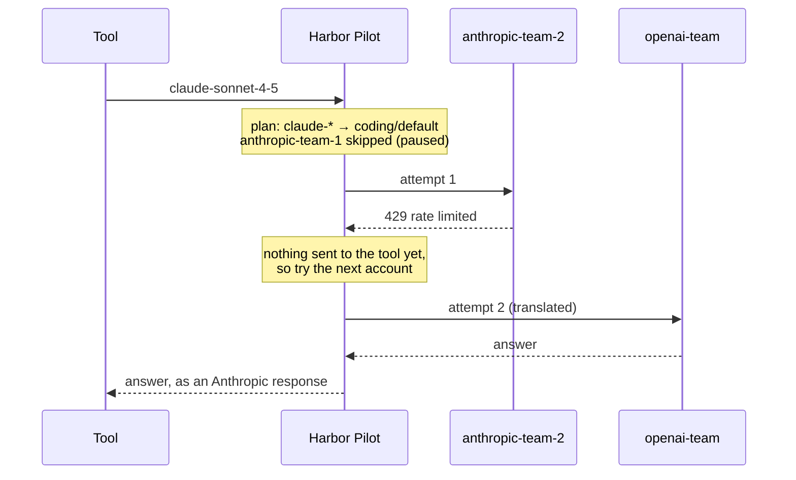

# Requests and "why this route"

**Monitor → Requests** lists every request that reached the gateway. Each request has a page that says in one sentence
where the request went and why, then shows the evidence: the route, every attempt, the accounts that were considered,
and the cost.

## Find a request

<Shot name="requests" alt="Requests list with tiles for requests, error rate, fallbacks and p95 latency, filters, and rows grouped by day showing client, requested and served model, status, latency and cost" caption="Requests: the last 24 hours, newest first" />

The tiles at the top cover the selected range: **Requests**, **Error rate**, **Fallbacks** and **Latency p95** (with the
median underneath).

Narrow the list with:

- **Search**: client, tool, model or request ID.
- **Show**: **All**, **Errors**, **Blocked** or **Fallbacks**.
- **Time range**: **Last 24 hours**, **Last 7 days**, **Last 30 days** or **All time**.
- **More filters**: **Client**, **Tool** and **Project**.

Rows are grouped by day. Each shows the time, the client and its tool, the model asked for and the model that served
it (`claude-sonnet-4-5 → demo-gpt`), the status, latency and estimated cost. A request that was served by a backup has
a yellow edge and a **Fallback** badge.

| Status | Meaning |
|---|---|
| **Running** | Still in progress |
| **Failed** | The gateway or every provider attempt failed |
| **Blocked** | Refused before reaching a provider: a rule, a budget, a privacy policy or a permission |
| **Canceled** | The client went away before the answer finished |
| **Fallback** | Answered, but not by the first choice |

## Sessions

**By session** groups requests into conversations, newest activity first. Each row shows the number of requests,
tokens in and out, estimated cost, how long the conversation ran, when its last request arrived and what it was
grouped by:

- **Reported by the tool**: the tool sent a session identifier with its requests.
- **From the access token**: Harbor Pilot grouped requests by the client's token because the tool sent nothing.

A session marked **Uncertain** was detected with low confidence. Opening a session filters the request list to it;
**Back to sessions** returns. Session grouping can be turned off per client under **Group requests into sessions**
([Clients](/operators/clients#settings)).

<Shot name="requests-sessions" alt="Requests grouped by session, with request counts, tokens in and out, estimated cost, duration, last request and how each session was grouped" caption="By session: one row per conversation" />

## The request page

Click a request to open its page. The title is the requested model and the model that served it; the badge says how
it ended (for example **OK · Fallback**). Under it, one sentence answers the question you came with:

> Served by openai-team · demo-gpt after anthropic-team-2 was rate limited (429). anthropic-team-1 was skipped: paused.

<Shot name="request" alt="Request page explaining that the request was served by openai-team with demo-gpt after anthropic-team-2 was rate limited and anthropic-team-1 was skipped because it was paused, followed by the route, attempts and candidates" caption="One sentence, then the evidence" />

Below the sentence:

| Section | What it shows |
|---|---|
| Facts | **Client**, **Tool**, **Plan** (with its version), **Latency**, **First token**, **Cost**, **When** |
| **Route** | **Requested** → **Matched** (the plan row, such as "Rule claude-\*", or "Asked by model name", or "Plan default") → **Model name** → **Fallback group** → **Served by**, marked _translated_ when the request was converted to the provider's format |
| **Attempts** | Every try in order, with why it failed: rate limited (429) with its retry-after, an error, a timeout, then the one that answered and whether it fell back to another account or provider |
| **Candidates** | Every account and model in the fallback group: ✓ tried or ✗ skipped, **Direct** or **Translated**, and why one was skipped (paused, limit reached, excluded by a rule, missing a capability) |
| **Cost** | The estimate and the tokens it is based on, for example "$0.0026 estimated · 900 in / 120 out / 2,000 cached" |
| Checks | Tools used, anything lost in translation, and what masking did: **No masking applied**, "N values masked before sending", **Checked for secrets: nothing to mask**, or **Blocked by the privacy policy** |

Four collapsed sections hold the detail most people need only now and then:

- **Verified context**: what the gateway established itself: client, project, workspace, session, protocol, required
  capabilities.
- **Reported by the tool**: what the tool claimed in its headers (session, project, purpose, reference). Harbor Pilot
  only trusts these where the client's settings allow it.
- **Accounting ledger**: the reservation and the final charge, and whether each figure came from the provider, the
  tool, or an estimate.
- **IDs**: request, credential, session and plan version IDs, each with a copy button.

### Reading a fallback

Harbor Pilot only fails over **before the first byte reaches your tool**, and only when the failed attempt provably did
not run. Once it starts streaming an answer, a later failure is passed on rather than retried, so a tool never sees two
answers spliced together. The fallback steps themselves are part of the [routing plan](/operators/routing#fallback-steps).

## Replay with current config

**Replay with current config** (top right of the request page) runs this request's routing again against today's
plan. Nothing is sent to a provider. Choose the account health to use:

- **Live account health**: today's quotas, pauses and limits.
- **All accounts available**: as if every account were healthy, to see what the plan itself would do.

The answer is one of **Same routing today**, **Routing would change** or **Would now be refused**, with what served the
request then and the first choice now. Use it after changing a plan to check that old traffic would still go where you
expect.

The same is available through the API as `POST /api/v1/activity/requests/{id}/replay` with
`{"health_mode": "current"}` or `{"health_mode": "assume_available"}`.

## On a phone

The list and the request page both fit a 390 px screen; the route and attempts stack vertically.

<Shot name="requests" mobile alt="Requests list on a phone with the tiles in two columns, the search and filters, and each request shown as a card" caption="Requests" />

<Shot name="request" mobile alt="Request page on a phone with the served-by sentence, facts and the start of the route" caption="A request" />

## Related

- [Routing plans](/operators/routing): where the route comes from.
- [Limits](/operators/limits): why an account was skipped as "limit reached".
- [Captured content](/operators/captured-content): keep short-lived copies of request bodies for debugging.
- [Troubleshooting](/operators/troubleshooting): common errors and what to do.
