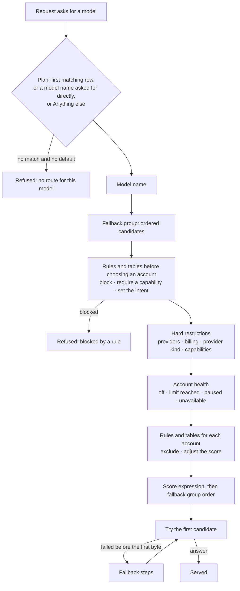

# Routing plans

Routing decides which account and model serve each request. **Configure → Routing** has three tabs, one for each
piece:

| Piece | What it is | Example |
|---|---|---|
| **Plans** | What a client's requests resolve to, plus rules, restrictions and what to do when an attempt fails. Each client uses one plan | "Team default": `claude-*` → `coding/default`, `gpt-*` → `coding/fast` |
| **Model names** | The names your tools ask for. Each points at a fallback group (or another model name) | `coding/default` → Coding default |
| **Fallback groups** | Ordered lists of account and model pairs that can serve the same requests | Team key 1 · demo-sonnet, then Team key 2 · demo-sonnet, then OpenAI team · demo-gpt |

Plans are **versioned**: you change a draft, check it, test it, and publish it. Drafts never affect traffic.
Model names and fallback groups are shared by all plans and change as soon as you save them.

## How a request is routed

The order matters:

1. The plan turns the requested model into a **model name**. A client that asks for a model name directly (for example
   `coding/default`) always gets it.
2. **Rules and tables that run before choosing an account** can block the request, require a capability, or set its
   intent.
3. **Hard restrictions** remove candidates the plan never allows. Nothing after this can bring them back.
4. **Account health** removes accounts that are off, out of quota, paused after a rate limit, or otherwise
   unavailable.
5. **Rules and tables for each account** can exclude a candidate or move it up or down.
6. The **score** orders what is left; ties keep the fallback group's order.
7. Harbor Pilot tries the first candidate. If it fails before anything reaches the tool, the **fallback steps** decide
   what to try next.

Every request page shows the result of each stage: which row matched, which candidates were skipped and why, which
rules fired ([Requests](/operators/requests#the-request-page)).

## Plans

<Shot name="routing" alt="Routing page, Plans tab, listing Team default and Private only with what each does in plain words, the live version and how many clients use it" caption="Plans, each described in one line" />

The **Plans** tab describes each plan in words: "claude-\* → Team key 1 (then 2 more) · gpt-\* → OpenAI team (then 1
more) · anything else → Team key 1 (then 2 more). Paid fallback allowed." It shows the live version and how many
clients use it. **+ Add plan** asks for a **Display name**, a short name and an optional **Description**; the plan has
no version until you create its first draft.

A plan's page repeats the summary and adds a policy line: which masking policy and content capture rule it uses,
its hard restrictions, and how many rules and tables are on.

<Shot name="plan" alt="Team default plan, Flow tab: requests for claude-* go to Team key 1, Team key 2 then OpenAI team, gpt-* to OpenAI team then Team key 1, and any other model to the default group, with the failover steps in a sentence" caption="A plan's Flow tab" />

- **Flow** shows, for each row, the model name and fallback group it uses and the accounts in the order they would be
  tried, then one sentence about failover: "If an attempt fails: try another account with the same model, then try
  another model in the group, then try another provider. Give up after 3 attempts. Paid accounts may be used as a
  fallback." When there is a draft, Flow opens on it and can switch to the live version. **Detailed graph** draws the
  whole decision; **View as JSON** shows the plan document.
- **History** lists the versions.
- **Test a request** is the [simulator](#test-a-request).

The ⋯ menu edits the name and description, or deletes the plan. A plan that clients still use can't be deleted; move
them to another plan first.

## Edit a draft

**New draft** copies the live version (or starts empty) and opens the editor. It has four tabs.

### Models and fallback

**Where requests go** is a table: **If the client asks for** a model or a glob such as `claude-sonnet-*`, **Use model
name**. The first matching row wins. The last row, **Anything else**, picks a model name for every other model, or
**Reject the request**. Rows can be reordered.

With no rows and **Reject the request** as the default, every request on the plan is refused, and the editor says so.

### Fallback steps

**If an attempt fails** lists the steps, in order:

| Step | What it does |
|---|---|
| **Retry the same account** | Try the same account and model again |
| **Try another account with the same model** | Next account in the fallback group that serves the same model |
| **Try another model in the fallback group** | Next candidate with a different model |
| **Try another provider** | Next candidate on a different provider |
| **Wait for capacity, then retry** | Wait, up to **Wait at most** seconds (0–600), for a rate limit or concurrency slot |

After the last step the request fails. A new plan uses **try another account**, then **try another model**. An empty
list means no fallback: the request fails on the first error.

- **Give up after** caps the attempts (1–10, default 3).
- **Allow paid fallback** lets a request that started on a subscription, free or local account fall back to a
  pay-per-use API account. It is off unless you tick it, and the editor warns that requests may then incur metered API
  charges.

Steps only run **before anything reaches the client**, and only when the failed attempt provably did not run. Once a
response has started streaming, or when Harbor Pilot can't tell whether the provider acted on the request, it is not
retried.

### Hard restrictions

Restrictions always apply first. Scores, rules and fallback can never get around them.

- **Providers**: **Any**, **Only these** or **All except these**.
- **Billing**: **Metered API (paid per use)**, **Subscription**, **Free**, **Local**. None ticked means any.
- **Provider kind**: **Official** (vendor APIs used as documented), **Partial** (compatible APIs with known gaps),
  **Unofficial**, **Local**. None ticked means any.
- **Every account must support**: capabilities such as tool calls, images or prompt caching.

For example, the demo's "Private only" plan sends everything to a local model; restricting it to **Local** makes sure no
rule or fallback can ever send its traffic to a cloud provider.

### Rules and decision tables

The **Rules** tab is for conditions that a plain mapping can't express: "block Codex on this plan", "prefer local
models for review requests", "never use metered accounts with stale quota data".

A **rule** has a **Name**, when it **Runs**, a **When** condition and an **Action**:

| Runs | Actions |
|---|---|
| **Before choosing an account** | **Block the request** (with a **Reason** returned to the client), **Require a capability**, **Set the intent** |
| **For each account in the fallback group** | **Exclude the candidate**, **Adjust the score** (positive moves it earlier, negative later) |

**When** is an expression that is true or false, for example `request.harness == 'codex'` or
`candidate.account.billing == 'metered_api'`. Click **Variables** for every value you can use; each expression is
checked as you type. An unknown value (such as quota that was never reported) makes a rule not apply; guard optional
values with `known(...)`. A request-stage rule can't refer to `candidate.*`.

A **decision table** is many similar rules in a grid. Each column reads one fact about the request (such as
`request.harness`); each cell compares it, like `value == 'codex'`, or `-` to match anything. **When several rows
match** sets the hit policy:

- **First matching row wins**.
- **Only one row may match**: more than one is a configuration error and nothing applies.
- **Every matching row applies**, in order.

Rules run in order within their stage; tables run after the rules of the same stage. An optional **Score expression**
gives each candidate a number; higher goes first, after exclusions and before fallback group order.

New rules and tables start **off**. Turn each **On** when it is ready. A rule or row that would block every request
gets a **Blocks every request** badge as soon as you write it.

The request's intent comes from, in order of trust: what the tool declared (only if its client
[trusts the purpose it declares](/operators/clients#settings)), then a rule's **Set the intent**, then the optional
classifier.

### Privacy and Compatibility

**Privacy** picks the plan's **Masking policy** and **Content capture rule** (both **None** by default). Manage them under
[Privacy](/operators/privacy) and [Captured content](/operators/captured-content).

**Compatibility** decides what happens when repeated translation failures open a provider path's circuit breaker:
**Skip the candidate** (the default), or **Use native passthrough** with losses you authorise in advance. Required
masking or an unenforceable blocking budget still refuse passthrough. See the
[compatibility matrix](/reference/compatibility).

**Save draft** saves it, with an optional note describing the change.

## Check, publish and roll back

A draft shows as **Draft vN — not live yet**, with a plain list of what changes from the live version ("Changes from
live v1: …"). From there:

- **Check for problems** validates the draft against today's configuration, such as model names, fallback groups or
  accounts that no longer exist and invalid expressions. Errors must be fixed before it can be published. It also runs the
  [blocks-traffic check](#the-blocks-traffic-check).
- **Test a request** opens the simulator on the draft.
- **Publish vN** shows who it affects ("It becomes active immediately for 3 clients using this plan"), the changes, and
  the check's result. **Publish** is disabled until the check passes, and when the draft is the same as live.
- **Discard** deletes the draft.

**History** lists every version with its note, who created and published it and when. A replaced version has **Compare
with live** (a plain list of differences) and **Roll back to this**, which publishes a copy of it as a new version.
The live version can be **Re-check**ed **against current configuration**, which catches a plan broken by a later change
to a model name or fallback group.

<Shot name="plan-versions" alt="Plan History tab showing v1 live with its note, when it was created and published, and View and Re-check against current configuration buttons" caption="History: every version, who published it, and roll back" />

Publishing and rolling back are separate permissions from editing (`policy.publish` and `config.write`), so you can let
people prepare drafts without letting them change live traffic.

Through the API, publish is `POST /api/v1/routing-plans/{id}/versions/{version_id}/publish` and rollback is
`POST /api/v1/routing-plans/{id}/rollback`. Both take an `If-Match` header with the version you expect to be live (or
`none`), so two people can't overwrite each other's release.

### The blocks-traffic check

A table whose rows look harmless can still match everything. So besides static validation, **Check for problems** sends
synthetic requests through the version, with every account assumed healthy: each mapped model, from each tool (Claude
Code, Codex, OpenCode, Pi and a generic client), streaming and not. If rules refuse all of them it reports:

> This version blocks every request: all 20 test requests (each mapped model, every tool, streaming or not) are refused
> by …

and if they refuse at least half, "blocks most requests", naming the rules or tables responsible.

Publishing or rolling back to such a version is still possible (a maintenance block can be deliberate), but the dialog
turns red, titled **This version blocks traffic**, and **Publish** stays disabled until you tick **I understand that
clients on this plan will have requests refused.** History marks such versions **Blocks every request**.

## Test a request

**Test a request** runs the plan without sending anything to a provider.

<Shot name="plan-simulator" alt="Test a request tab with an Ask for model field set to coding/default on the live version, a Test button and More conditions" caption="Test a request: ask for a model and see where it goes" />

Enter the model to **Ask for**, choose the version (the draft, live, or an older replaced one), and **Test**. **More
conditions** sets everything else a rule might look at: **Client protocol**, **Tool names the client offers**,
**Declared intent**, **Session confidence**, **Streaming**, **Contains images**, **Evaluation time**, and **Account
health**: **Current live health** or **Assume every account is available**, with per-account overrides for health,
quota left and stale quota.

The answer is one line, then the reasons:

- **Goes to Team key 1 · demo-sonnet**, "If that fails: Team key 2, then OpenAI team."
- or why it would be refused: **Blocked by a rule**, **No route for this model**, **Not allowed for this client**, **No
  account has quota left**, **Every account is rate limited**, **Budget used up**, **No account supports this
  request**.

**Why** shows the accounts in the order they would be tried (with scores), the ones skipped and why, and every rule
evaluation. The API is `POST /api/v1/routing-plans/{id}/simulate`.

To check a real past request against today's plan, use [Replay with current config](/operators/requests#replay-with-current-config)
on its request page.

## Model names

**Model names** are what your tools ask for. Pick names for the job, not the vendor: `coding/default`, `coding/fast`,
`review/deep`. Then a plan can point `claude-*` at `coding/default` today and something else tomorrow without touching
any tool.

**+ Add model name**:

- **Model name**: lowercase letters, digits, dots, dashes or underscores, in up to four parts separated by `/`. It
  can't be changed later.
- **Description** (optional).
- **Goes to**: **A fallback group**, or **Another model name** (names that would lead back to this one are not
  offered).
- **Every account must support**: capabilities required of every candidate, such as tool calls or images.

## Fallback groups

<Shot name="fallback-groups" alt="Fallback groups tab with Coding default, Coding fast and Local only, how each chooses accounts, whether conversations stay on one account, the ordered accounts and models, and which model name uses each" caption="Fallback groups: the accounts a model name can use" />

A **fallback group** is the ordered list of account and model pairs that can serve the same requests. Use it to spread
load across seats or keys, or to say "Claude first, then GPT".

**+ Add fallback group**:

- **Display name**.
- **How accounts are chosen** (plans may override this):
  - **Tried in order**.
  - **Spread by weight** (each row gets a weight).
  - **Quota that resets soonest first**: use up the window that is about to reset anyway.
  - **Least used first**.
  - **Take turns**.
- **Conversations**: **Keep a conversation on the same account** (prompt-cache friendly) or **Choose freely for every
  request**.
- Rows of **Account** and **Model**: the model list comes from the provider; providers without a model list take any
  model id.

A fallback group with no accounts rejects every request.

## Related

- [Concepts](/guide/concepts): the pieces in one page.
- [Requests](/operators/requests): see the routing of real requests.
- [Providers and accounts](/operators/providers), [Subscriptions](/operators/subscriptions).
- [Terraform](/operators/terraform): manage plans as code.
