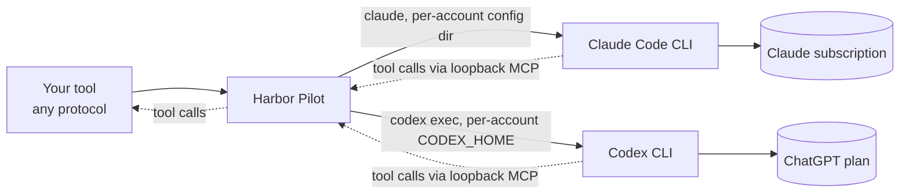

# Subscriptions and CLI bridges

A Claude Pro or Max plan, or a ChatGPT Plus or Pro plan, comes with a lot of model use for a flat fee. Harbor Pilot can
route requests to those subscriptions, next to your API keys and local models, and fail over between them.

It does this the only way the vendors support: by running the vendor's own command-line tool on the Harbor Pilot
server, signed in with that subscription. Harbor Pilot calls these **CLI bridges**. It never replays a subscription's
OAuth tokens against a private API and never pretends to be the vendor's client in HTTP headers.



::: warning Not yet run against a real subscription
The Claude Code bridge is contract-tested against the real `claude` binary (2.1.318) with a synthetic upstream. The
Codex bridge is contract-tested against a fake binary that emits the documented events. Neither has been run against a
real subscription yet. See the [compatibility matrix](/reference/compatibility).
:::

## Before you start

The server needs the vendor CLI installed:

- **Claude Code**: the `claude` binary.
- **Codex**: the `codex` binary.

Harbor Pilot looks for each on `PATH`, or at `bridges.claude_code.binary` and `bridges.codex.binary` in the
[configuration](/reference/configuration). The `harbor-pilot-bridge` container image ships both CLIs (Claude Code 2.1.318 and Codex 0.166.0 at the time of writing); the plain `harbor-pilot` image does not. See [Install with Docker](/guide/install-docker). **Settings → System & backups →
CLI bridges** shows each bridge as **Available** (with its version and path), **Self-test failed** or **Unavailable**.
Home tells you when an account depends on a CLI that can't run.

## Add a subscription account

1. **Providers → + Connect a provider**, choose **Claude Code CLI bridge** or **Codex CLI bridge**, name it, and click
   **Connect provider**. A bridge provider has no address or API key; it runs the vendor's CLI on this server.
2. On the new provider, **+ Add account**. Set **How it is paid** to **Subscription**.
3. Paste the account's sign-in credential, which the dialog explains how to get:

### Claude: a sign-in token

> **Get a sign-in token for this subscription.** On a machine where you are signed in to Claude Code with that
> subscription, run this and paste the token it prints (it starts with `sk-ant-oat`). Each account needs its own
> subscription login.

```sh
claude setup-token
```

### Codex: a sign-in file

> **Get a sign-in file for this ChatGPT plan.** Sign in to Codex in a separate folder, then paste the whole contents of
> the auth.json file it writes.

```sh
export CODEX_HOME="$(mktemp -d)" && codex login && cat "$CODEX_HOME/auth.json"
```

Both are stored encrypted, like an API key, or can be given as a [secret reference](/operators/providers#api-keys-and-secret-references).
Each subscription seat is one account; add one account per seat and put them in the same
[fallback group](/operators/routing#fallback-groups) to fail over between seats.

**Test connection** on a bridge account can't prove much without spending a turn: it says **Ready to use** when the
CLI can run. The account is confirmed by its first real request.

## How a bridge runs

For every request Harbor Pilot starts (or reuses) a CLI process for that account:

- **Claude Code** runs `claude` with the account's token in `CLAUDE_CODE_OAUTH_TOKEN` and its own configuration
  directory under the data directory (`bridges/<kind>/<account id>/`), so seats never share state. The CLI's built-in
  tools are off (`--tools ""`), only Harbor Pilot's MCP server is loaded (`--strict-mcp-config`), and no user or project
  settings are read (`--setting-sources ""`).
- **Codex** runs `codex exec --json` with its own `CODEX_HOME`, seeded once from the account's `auth.json`. Built-in
  tools are turned off and it runs in a read-only sandbox. If the CLI still starts a command, a file change or a web
  search, the turn is stopped with an error instead of served.

Your tool's own tools (Read, Edit, Bash, …) still work: Harbor Pilot offers them to the CLI through a per-request MCP
endpoint on the loopback interface, and passes each tool call back to your tool as a normal tool call in its own
protocol. Commands run on your machine, not on the server.

Usage reported by the CLI is accounted like any other request. Claude Code also reports its **5-hour** and **7-day**
windows; these feed [Limits](/operators/limits), and a used-up window makes routing skip the seat until it resets. For
Codex, add a **ChatGPT / Codex plan** [quota tracker](/operators/limits#quota-tracking).

## Subscriptions and fees

Record what you pay for a subscription so [Spend](/operators/spend) can show it next to usage, never added to it. Open
the account from **Providers** and, under **Subscription**, click **Add subscription**:

<Shot name="subscription-add" alt="Add a subscription dialog over an account's drawer, with plan name, short name, fee, currency, billing period, start and end dates, and an Add window button for usage windows" caption="Add a subscription: what you pay, how often, and the windows the plan advertises" />

| Field | Notes |
|---|---|
| **Account** | The account the subscription belongs to |
| **Plan name** | For example "Max 20x" |
| **Fee** and **Currency** | What you pay per billing period |
| **Billed** | **Every month** or **Every year** |
| **Starts on**, **Ends on** | Leave **Ends on** empty while it renews |
| **Usage windows** | The limits the plan advertises |

Each usage window has a **Length** (**5-hour session**, **Daily**, **Weekly**, **Monthly (30 days)**, or **Other
length** in **Hours**), a **Limit** and what it is **Measured in** (percent of the allowance, tokens, requests, credits,
or not published). Declared windows are used for forecasts and shown on the account until quota tracking reports live
usage ("Declared by its subscription: 5-hour window. Live usage is not tracked yet."). Live usage always comes from
quota tracking or the bridge itself.

<Shot name="subscriptions" alt="Editing the Team plan (synthetic) subscription of Team key 1: a fee of 150.00 USD every month since 1 Jan 2026, and two usage windows, a 5-hour session and a weekly window, each measured in percent of the allowance with a limit of 100" caption="A recorded subscription with its declared usage windows" />

Fees are prorated to the range you look at on Spend. **Subscription value** on Spend prices the subscription's usage at
public API list prices so you can compare; it is not a charge.

## Paid fallback

When every subscription seat is used up, should requests spill over to a pay-per-use API key? That is a choice per
routing plan: **Allow paid fallback** ([routing](/operators/routing#fallback-steps)). It is off by default, so
subscription traffic never quietly turns into an API bill.

## Limitations

- Bridges run on the Harbor Pilot host, need the vendor binary and a login per account there, and add process start-up
  time to each request.
- They expose only what the CLI exposes: no native passthrough, and usage only as detailed as the CLI reports it.
- Through Claude Code the model sees a system prompt that starts with the CLI's own identity line, and your tool's tools
  appear to it with an `mcp__client__` prefix (names are mapped back for your tool). Sampling parameters, stop
  sequences, output limits and forced tool choice are not passed on; each is recorded on the request as an
  approximate loss. Provider-run tools such as web search are not available.
- A CLI process waiting for a tool result is held in memory. A restart loses it; the next request resumes from the
  transcript, with a recorded loss.
- Codex runs one turn per process and continues earlier turns with `codex exec resume`. A conversation it has not seen
  before is replayed to it as text. Its rollouts are kept for the thread TTL (24 hours by default).
- Codex refreshes its sign-in file in place, so only one Codex process per account runs at a time by default
  (`bridges.codex.max_per_account`).
- Bridges run as the same operating-system user as the server. Their tools are off and sandboxed, but for defence in
  depth run them under a separate user, or in a container that can't read the data directory and the master key.

Using a subscription through Harbor Pilot is still using it through the vendor's own CLI, under that vendor's terms.
Check that your plan allows it for your use.

See [Known limitations](/security/limitations) for the full list.
