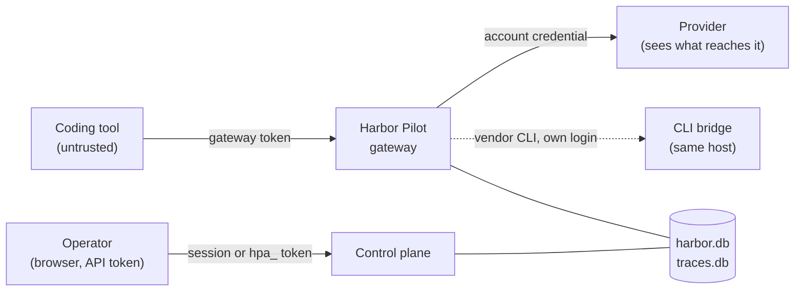

# Security model

Harbor Pilot sits between your coding tools and your model providers. It holds the credentials that pay for model
access, it sees every prompt and response that passes through, and it decides where each request goes. This page says
what it protects, against whom, and where its protection stops.

Everything below is implemented and covered by tests against fixtures, fakes and synthetic upstreams; none of it has
been verified against live provider accounts yet (see the
[compatibility matrix](/reference/compatibility)).

## Trust boundaries

- **Coding tools are untrusted.** A tool, or the agent driving it, may have a shell, may leak its own token and may be
  steered by prompt injection. Its token reaches only its own client's routing plan, limits and budgets. Headers it
  sends (project, session, intent, run references) are recorded as claims and never authorize anything on their own.
- **Operators are trusted with configuration.** Roles (`admin`, `operator`, `viewer`) decide who may change what.
  Reading prompt content is never implied by a role: it needs explicit, audited grants.
- **Providers see what reaches them.** Masking reduces what they see; it is not a guarantee.
- **The host is trusted.** Anyone with root on the Harbor Pilot host can read the master key and the CLI bridge logins.

## What Harbor Pilot guarantees

- **Tools never see provider credentials.** The gateway token a tool uses is never forwarded. Upstream requests carry
  only the account's own credential, built from an allowlist of headers.
- **Credentials are encrypted at rest** under a master key that is never stored in the database or in backups. See
  [Secrets and the master key](/security/secrets).
- **Secrets stay out of the side channels.** Logs, metrics labels, events, notifications, error messages, the audit
  log and Terraform output never carry credential values. Provider error messages that echo a key are scrubbed before
  they are stored or returned. A test plants canary secrets everywhere a secret can be set and checks every surface,
  including the raw database files.
- **Sessions resist the usual web attacks.** Server-side sessions in `__Host-` cookies, an origin check plus a CSRF
  token on every change, rotation at sign-in, idle and absolute expiry, and login throttling that holds under
  parallel guesses.
- **Sensitive reads need a recent sign-in.** Reading unredacted captured content, exporting it, and setting a first
  password on an SSO-only account need a sign-in within the last 10 minutes. API tokens never qualify.
- **Captured content expires for real.** Content capture is off by default. When a rule turns it on, content is
  encrypted with a key per day and policy, expiry destroys that key, and deleted text is removed from the database
  files. See [Captured content](/operators/captured-content).
- **Outbound connections cannot be pointed inward.** Provider, webhook, alert, quota-tracking, sign-in and Pulse
  connections refuse loopback and private addresses unless that destination explicitly allows them, and always refuse
  cloud metadata addresses, whatever the setting.
- **Every change is audited.** Configuration changes, publishes, token issues and revocations, content reads and
  exports, and sign-ins are recorded in the audit log.

## What it does not do

- **It does not sandbox your tools.** A tool can still call a provider directly with any credential it holds itself.
- **It does not guarantee masking.** Detectors miss formats they do not know. See
  [Masking: guarantees and limits](/security/masking).
- **It is not highly available.** One instance per data directory, SQLite with one writer. Recovery is restore from
  backup.
- **It does not avoid provider rules.** Routing chooses among accounts you are allowed to use; it does not hide that
  traffic from providers or avoid their rate limits and restrictions.
- **It has no second factor for local accounts.** Use single sign-on with an identity provider that enforces one.

## Threats and how they are handled

| Threat | Mitigation |
|---|---|
| An agent steals its tool's token | Tokens are scoped to one client, can expire, and can be revoked; orchestrators can mint short-lived child tokens bound to a run. A stolen token reaches only that client's plan and budgets. |
| Credential exfiltration through the gateway | Outbound headers are allowlisted; client `Authorization` and `x-api-key` are never forwarded; provider and CLI error text is scrubbed of the attempt's credential and key-shaped strings. |
| Secret references as an exfiltration channel | `env:` references read only variables with an allowed prefix (default `HP_SECRET_`); the master key variables are never readable; `file:` references are confined to configured roots that may not contain the data directory or key files. |
| Server-side request forgery | Every outbound connection goes through one network policy with per-connection DNS pinning, same-host redirects only, and bounded sizes and timeouts. Stored secrets do not follow a destination to a new origin. |
| Header spoofing | Project, session and run headers are claims. Trusted references come from the client or from the token's mint call; on conflict the trusted value wins and the conflict is recorded. |
| Prompt injection steering routing | Prompts and classifier output are data only. An intent cannot widen permissions, raise a budget or pick an account outside the plan. |
| Placeholder abuse | Masked values come back only into text. Restoring into tool arguments is off by default and limited to allowlisted tools, fields and hosts. |
| CSRF, fixation, stolen sessions | `__Host-` cookies, origin plus HMAC CSRF token, session rotation at sign-in, step-up for sensitive reads. |
| Brute force | Per-account and per-address throttling that reserves each attempt before checking it; gateway credential failures are limited per address. |
| SSO account takeover | An existing account is linked to an identity provider only when an administrator marked it for that provider; `allowed_domains` always applies. |
| Webhook spoofing and replay | Signed with `X-Harbor-Signature` (HMAC-SHA256 over timestamp and body); both secrets sign during rotation; receivers check a 5-minute window and deduplicate by event id. |
| Alert storms | Notification failures never create events, rules cannot subscribe to notification events, and cooldowns and grouping apply. |
| Large or slow requests | Body and parser limits, per-client concurrency, bounded writes to slow clients, idle timeouts on upstream streams. |
| Malicious routing expressions | Expressions compile against a typed environment with node and memory limits and no I/O. Publishing needs the operator role and is audited. |
| CLI bridge escapes | The vendor CLIs run with their own tools turned off, a fail-closed check stops any turn that uses one anyway, secrets never appear in process arguments, and conversation files are removed when processes end, except a Claude Code session ended between turns, which is kept up to its prompt-cache lifetime (at most an hour) so the next turn reads the cache. |

The full threat model, with every asset and actor, is in
[docs/THREAT_MODEL.md](https://github.com/aurimasniekis/go-harbor-pilot/blob/main/docs/THREAT_MODEL.md). Decisions
D-035 to D-039 in
[docs/DECISIONS.md](https://github.com/aurimasniekis/go-harbor-pilot/blob/main/docs/DECISIONS.md) record the hardening
that followed the security review.

## Running it safely

- Serve it over HTTPS (`server.public_url`); plain HTTP drops the `Secure` cookie flag and is for local use only.
- Keep the master key outside the data directory, mode `0600`, and back it up separately from the database backups.
- Put secrets you reference in `HP_SECRET_`-prefixed variables or in a dedicated secrets directory.
- Set `server.trusted_proxies` behind a reverse proxy, and `server.metrics_token_file` if `/metrics` is reachable.
- Run the bridge image or service under its own user or container if you use CLI bridges, so a misbehaving vendor CLI
  cannot read the data directory.
- Never expose the demo: it refuses non-loopback addresses for a reason.

## Reporting a vulnerability

Report vulnerabilities privately through
[GitHub security advisories](https://github.com/aurimasniekis/go-harbor-pilot/security/advisories/new), not in public
issues.
