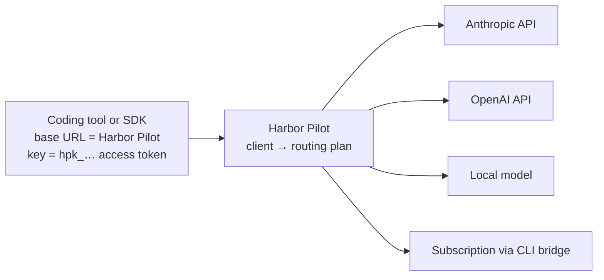

# Connect your tools

Every tool connects the same way: it sends requests to Harbor Pilot instead of a provider, with a Harbor Pilot access
token instead of a provider key. Harbor Pilot then routes the request with the client's plan, and the tool never sees
a provider credential.



## Supported tools

| Tool | Speaks | Configured in | Token comes from | Status |
|---|---|---|---|---|
| [Claude Code](/tools/claude-code) | Anthropic Messages | `~/.claude/settings.json` | a token file, through `apiKeyHelper` | request shape contract-tested; live run pending |
| [Codex](/tools/codex) | OpenAI Responses | `~/.codex/config.toml` | the `HARBOR_PILOT_TOKEN` variable | configuration from Codex's documentation; not yet run against Codex |
| [OpenCode](/tools/opencode) | OpenAI Chat Completions | `~/.config/opencode/opencode.json` | a token file, through `{file:…}` | configuration from OpenCode's documentation; not yet run against OpenCode |
| [Pi](/tools/pi) | OpenAI Chat Completions | `~/.pi/agent/models.json` | the `HARBOR_PILOT_TOKEN` variable | configuration from Pi's documentation; not yet run against Pi |
| [SDKs and API clients](/tools/sdks) | Anthropic, OpenAI or Gemini | the app's environment | an environment variable | endpoints contract-tested |
| [Agent orchestrators](/tools/orchestrators) | any of the above | the orchestrator | short-lived run tokens it creates | contract-tested |

"Contract-tested" means the behaviour is covered by automated tests against recorded protocol shapes, not that it was
run against the real tool with a real account. The [compatibility matrix](/reference/compatibility) has the details
and is updated as live runs are recorded.

## The pattern

1. **Create a client** for the tool under **Clients → Add client**, and pick its routing plan. One client per tool and
   place (a laptop, a CI job, an orchestrator) keeps requests, limits and tokens apart.
2. **Get an access token.** Creating the client shows its first token once; more come from the client's **Access
   tokens** tab or `harbor-pilot token issue`.
3. **Point the tool at Harbor Pilot**, by hand or with `harbor-pilot harness setup <tool>`.
4. **Ask for a model name** such as `coding/default`. The plan decides what that means; a model the plan doesn't map
   goes to its default model name.

<Shot name="clients" alt="Clients page listing Claude Code on a laptop, Codex in CI, SpaceMan runs and a private notebook, each with status, requests, failures and cost" caption="One client per tool and place" />

## Set up a tool page

**Clients → Set up a tool** builds the exact steps for a client, a model name and a tool from your server's public
address: the configuration snippet, a command that saves the token to a file without echoing it, and the
`harbor-pilot` commands to apply, check and undo the setup.

<Shot name="client-setup" alt="Set up a tool page with a client and model chosen, Claude Code selected, and the settings.json snippet with apiKeyHelper and ANTHROPIC_BASE_URL" caption="Copyable setup steps for each tool" />

## The `harbor-pilot harness` commands

The same binary configures tools on a workstation. It edits only the tool's own configuration file and remembers what
it changed.

```sh
harbor-pilot harness preview <tool> --url https://pilot.example.com --token-file ~/.config/harbor-pilot/tokens/<tool>.token
harbor-pilot harness setup <tool> --url https://pilot.example.com --token-stdin --model coding/default --yes < token
harbor-pilot harness status
harbor-pilot harness uninstall <tool> --yes                   # removes only what setup added
harbor-pilot harness uninstall <tool> --restore-backup --yes  # puts the original file back
```

`<tool>` is `claude`, `codex`, `opencode` or `pi`.

| Flag | Meaning |
|---|---|
| `--url` | Harbor Pilot's public address. Defaults to `HP_PUBLIC_URL`. |
| `--token-stdin` | Read the token from stdin and save it to `~/.config/harbor-pilot/tokens/<tool>.token` with mode 0600. |
| `--token-file` | Use a token file you already have. |
| `--token-env` | Tell the tool to read the token from this environment variable instead of a file. |
| `--model` | The model name to select, for example `coding/default`. |
| `--config-dir` | The tool's configuration directory, if not the default. |
| `--yes` | Apply the change. Without it, `setup` only prints the diff. |

Before writing, `setup` backs up the file next to it (`<file>.hp-backup-<time>`), writes atomically, and records the
keys it added in `<file>.hp-managed.json`. `status` shows each tool as not configured, configured, or configured and
edited since.

The token never goes on the command line. You can pipe it straight from `token issue`, so it never appears on screen:

```sh
harbor-pilot token issue --server https://pilot.example.com \
  --api-token-file ~/.config/harbor-pilot/api.token --binding <client-id> --name laptop \
  | harbor-pilot harness setup claude --url https://pilot.example.com --token-stdin --model coding/default --yes
```

## Next

- [Clients and access tokens](/operators/clients): limits, allowed models, projects and token rotation.
- [Gateway endpoints](/reference/gateway): every path Harbor Pilot accepts.
