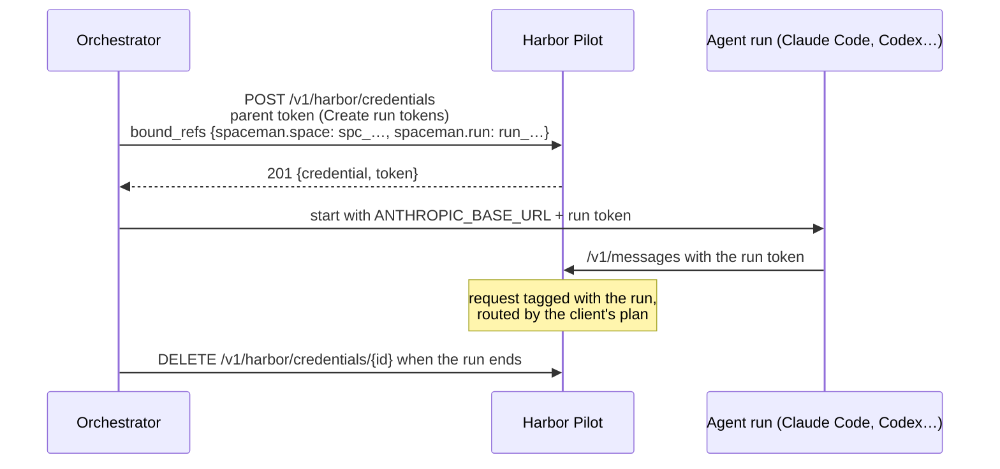

# Agent orchestrators

An orchestrator such as [SpaceMan](https://github.com/aurimasniekis/go-spaceman) starts many agent runs, each one a
coding tool with its own task. Giving every run the same long-lived token makes it impossible to tell runs apart and
dangerous to leak one. Harbor Pilot instead lets the orchestrator create a **run token** for each run: short-lived,
narrower than its parent, and carrying references that identify the run.

::: info Status
Run tokens are contract-tested (`TestMintChildConfinesBoundRefs`, `TestMintChildRecordsParentAsCreator`, the SpaceMan
acceptance scenario and `TestDemoSpaceManRunsBindingAcceptsPerRunRefs` against the demo seed). SpaceMan does
not create run tokens yet; this page describes the Harbor Pilot side, which any orchestrator can use.
:::

## How it works



1. Create a client for the orchestrator, for example `spaceman-runs`, with a routing plan, a project and limits.
2. Create one token for it with the **Create run tokens** permission (`tokens:mint`), and keep that token on the
   orchestrator's central server. Agents never see it.
3. When a run starts, the orchestrator creates a run token and hands it to that run only.
4. When the run ends, the orchestrator revokes it. The expiry is a backstop.

## Create a run token

```sh
curl https://pilot.example.com/v1/harbor/credentials \
  -H "Authorization: Bearer $PARENT_TOKEN" \
  -H "Content-Type: application/json" \
  -d '{
    "name": "run run_01JD…",
    "scopes": ["gateway:invoke"],
    "ttl_seconds": 7200,
    "bound_refs": {"spaceman.space": "spc_…", "spaceman.run": "run_01JD…", "session": "run_01JD…", "project_id": "prj_…"}
  }'
```

The answer is `201 Created` with the credential's details and its token, shown this once:

```json
{
  "credential": {
    "id": "crd_…",
    "binding_id": "cbn_…",
    "parent_id": "crd_…",
    "scopes": ["gateway:invoke"],
    "bound_refs": {"project_id": "prj_…", "session": "run_01JD…", "spaceman.run": "run_01JD…", "spaceman.space": "spc_…"},
    "created_by": "crd_…",
    "expires_at": "…"
  },
  "token": "hpk_…"
}
```

| Field | Meaning |
|---|---|
| `name` | Required, 1–80 characters. Shown on the client's **Access tokens** tab. |
| `scopes` | A subset of the parent's, never `tokens:mint`. Defaults to sending requests and listing models. |
| `ttl_seconds` | Lifetime. Defaults to 12 hours, at most 7 days, and never longer than the parent's. |
| `bound_refs` | References tied to the token, as `key: value` strings. |

`bound_refs` in the answer are the references stored on the run token: the parent token's own references plus the
ones you sent. References configured on the client are not copied in; they are added to each request (see below).
`created_by` is the parent token's id, so the client's **Access tokens** tab and the audit log show which token created
each run token.

A run token belongs to the same client as its parent, so it uses the same plan, limits and allowed models. It can't
create further tokens.

## Bound references

References bound at creation are **trusted**: an authenticated orchestrator set them, and the agent can't change them.
Harbor Pilot records them on every request the token makes.

| Key | Effect |
|---|---|
| `run`, `spaceman.run` or `ci.job` | The run reference on each usage entry, so spend adds up per run. |
| `session` | Groups the run's requests into one session, with high confidence. |
| `project_id` | Charges the run to a project. It must be the client's project or one of its allowed projects. |
| anything else | Recorded as a trusted reference for reporting, for example `spaceman.space`. |

A run token carries the parent's references, copied in when it is created. The references configured on the client
(under the client's **References** setting) are applied when each request is made, for every key the token doesn't
bind itself. A run token can add references, but it can't change either kind: sending a key the parent or the client
already sets, with a different value, is refused with `400`. Sending the same value is accepted.

So configure on the client only what every run shares, for example `spaceman.fleet`, and bind what differs per run
(`spaceman.space`, `spaceman.run`, `project_id`) when you create the run token. A client that pins `spaceman.space`
can serve only that one space.

Headers the agent sends, such as `X-HP-Session` or `X-HP-External-Ref`, are hints. They are recorded as claims next to
the trusted references, and never decide access or billing.

<Shot name="request-run-refs" alt="A request made with a run token of the spaceman-runs client, with Verified context open: client, project, workspace, protocol and required capabilities, then the trusted references spaceman.fleet fleet_synthetic, spaceman.run run_synthetic_2, spaceman.space spc_synthetic and spaceman.task tsk_synthetic_7" caption="A run token's request: its trusted references under Verified context" />

## Hand the token to the run

Give the run its token like any other tool, in the run's environment:

```sh
# Claude Code
ANTHROPIC_BASE_URL=https://pilot.example.com
ANTHROPIC_AUTH_TOKEN=hpk_…            # the run token

# Codex
HARBOR_PILOT_TOKEN=hpk_…
codex -c model_provider=harbor-pilot \
  -c model_providers.harbor-pilot.base_url=https://pilot.example.com/v1 \
  -c model_providers.harbor-pilot.wire_api=responses \
  -c model_providers.harbor-pilot.env_key=HARBOR_PILOT_TOKEN …
```

An agent with shell access can read anything in its environment, the run token included. That is why run tokens are
short-lived, limited to sending requests, and tied to one run: a leaked run token is worth one client's plan for a few
hours, and its requests are all labelled with the run.

## Revoke it

```sh
curl -X DELETE https://pilot.example.com/v1/harbor/credentials/crd_… \
  -H "Authorization: Bearer $PARENT_TOKEN"
```

Either the parent token or the run token itself may revoke a run token; the answer is `204 No Content`. Any other
token gets `404`.

## Budgets

Creating a run token does not check budgets: a run token is created even when a blocking budget that covers the
client or its project is already used up. Its requests are then refused with `429` and the error code
`budget_exceeded`, the first time it is used.

To follow budget refusals:

- `budget.threshold.exceeded` is sent **once per budget period**, when the budget is first used up.
- `access.request.blocked` is sent for **every** request a blocking budget refuses, with the budget in `reason`. The
  request shows as **Blocked** in **Requests**.

To refuse a run early, check the budget before creating its token, under **Limits** or with
`GET /api/v1/budgets/status`.

## See the runs

Runs show up like any other client's traffic: under the orchestrator's client, in **Requests**, and in **Spend**
broken down by client and project.

<Shot name="client" alt="A client page with recent requests, its access tokens and the setup steps for its tool" caption="The orchestrator's client: its requests and tokens" />

The demo has a `spaceman-runs` client with the **Create run tokens** permission, if you want to try this locally. It
pins only `spaceman.fleet` (`fleet_synthetic`) and allows the `web-app` and `data-pipeline` projects, so each run
token can bind its own `spaceman.space` and `project_id`. See [Try the demo](/guide/demo).

## With Terraform

The Terraform provider can create the Harbor Pilot side (project, client, plan and the parent token); its
`examples/scenarios/07-spaceman-integration` shows a complete setup. See
[Terraform](/operators/terraform).
